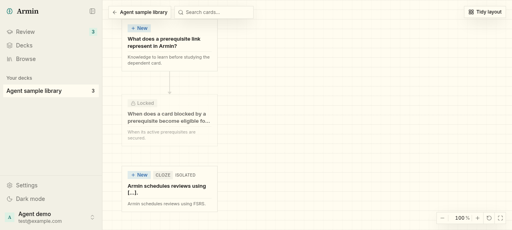

# Local Convex deployments for development

Verified on 2026-10-21 in a T3 Code task worktree on Linux, with Node 24.20.0
on `PATH` and Convex CLI 1.47.0. Browser checks used headless Chromium through
the task's named agent-browser session at its default 1280 × 577 viewport. No
physical phone or emulator walkthrough was performed.

## Setup

1. `pnpm worktree:setup` downloaded the local backend binary, allocated web
   25496, Expo 25497, Convex API 25498, and Convex HTTP 25499, and started the
   backend. Functions and components pushed ("Convex functions ready"), and three
   env vars (`SITE_URL`, `MOBILE_TRUSTED_ORIGINS`, `BETTER_AUTH_SECRET`) were set.
   Client URLs were written and the sample library was seeded. The backend then
   stopped: no listener remained on 25498/25499.
2. `packages/backend/.env.local` held `CONVEX_DEPLOYMENT=anonymous:anonymous-agent`
   and `CONVEX_URL=http://127.0.0.1:25498`, with no deploy key and no `dev:`
   cloud selection. The CLI reported "No Convex account", so no cloud deployment
   was created.
3. Rerunning setup through `pnpm --filter @armin/backend dev:setup` reused the same
   ports and deployment, reported "Test login verified; keeping all existing
   sample data", and stopped the backend again.
4. With Node 26 on `PATH`, setup stopped immediately with the Node 24 message,
   before touching any state.

## Running app

1. `pnpm dev` started Vite on 25496 and the local backend on 25498/25499.
2. `GET /api/auth/get-session` on the worktree origin returned HTTP 200 with
   body `null` (signed out).
3. In the browser, `http://armin-2c1e6ebca1.localhost:25496/` redirected to sign-in.
   Signing in as `test@example.com` / `armin1234` opened Decks with
   "Agent sample library" (4 flashcards, 3 due).
4. Opening the deck listed the four sample cards, with the dependent card
   marked Locked. The Graph view showed the prerequisite edge:

   

5. From the same machine, `http://192.168.0.13:25498/version` and
   `http://192.168.0.13:25499/api/auth/get-session` returned HTTP 200, showing
   the backend is reachable on the LAN address written to the mobile `.env.local`.
   Reachability from an actual phone was not tested.
6. Ctrl+C (SIGINT to `pnpm dev`) stopped Vite and the local backend.
