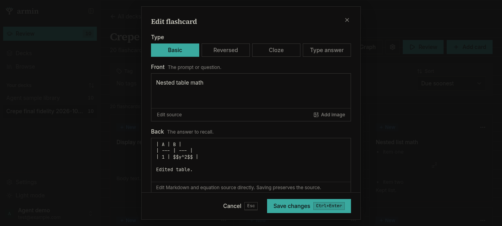
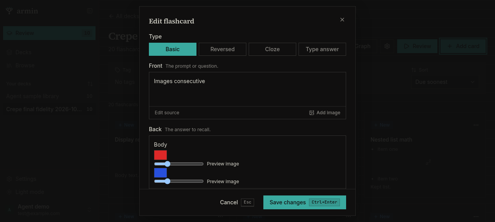
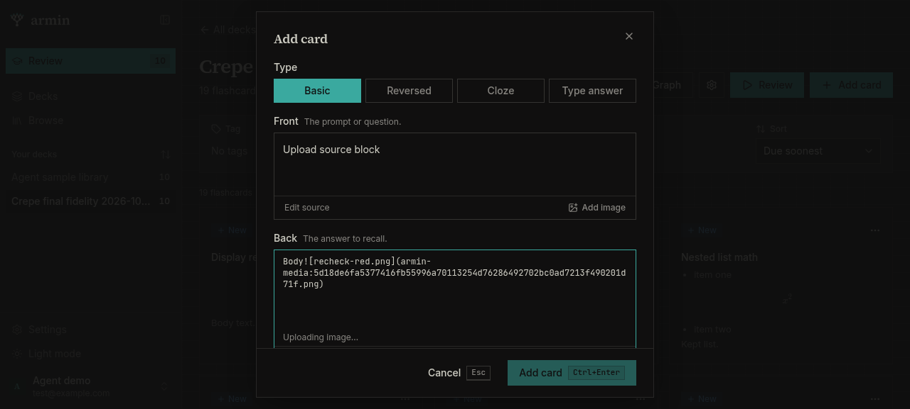
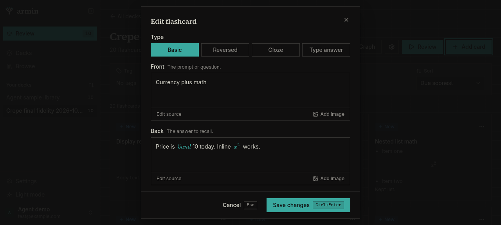
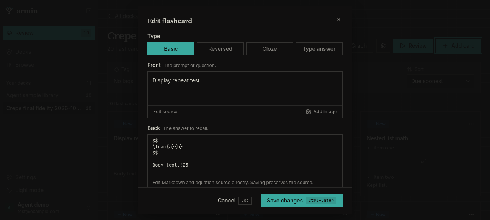
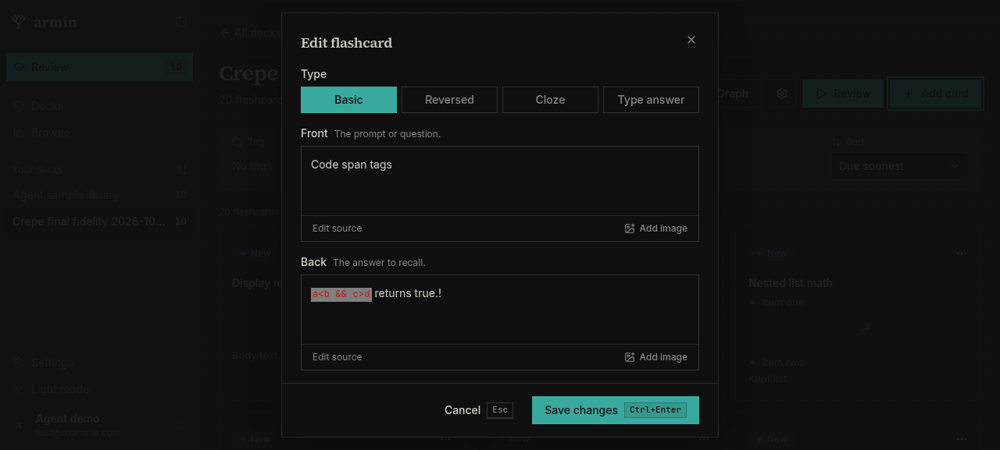
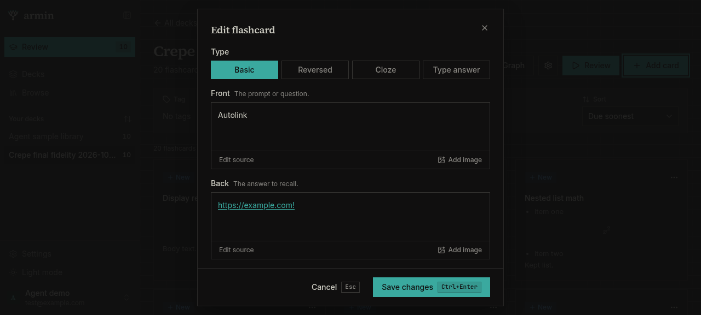
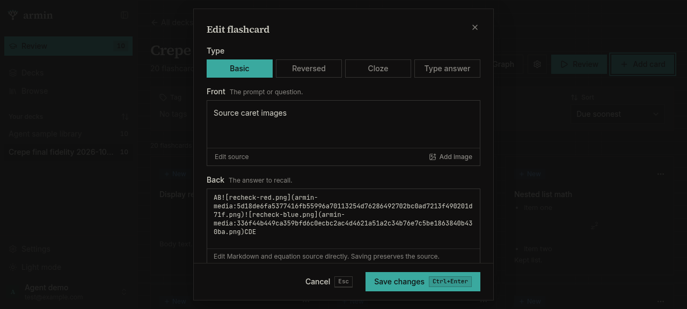
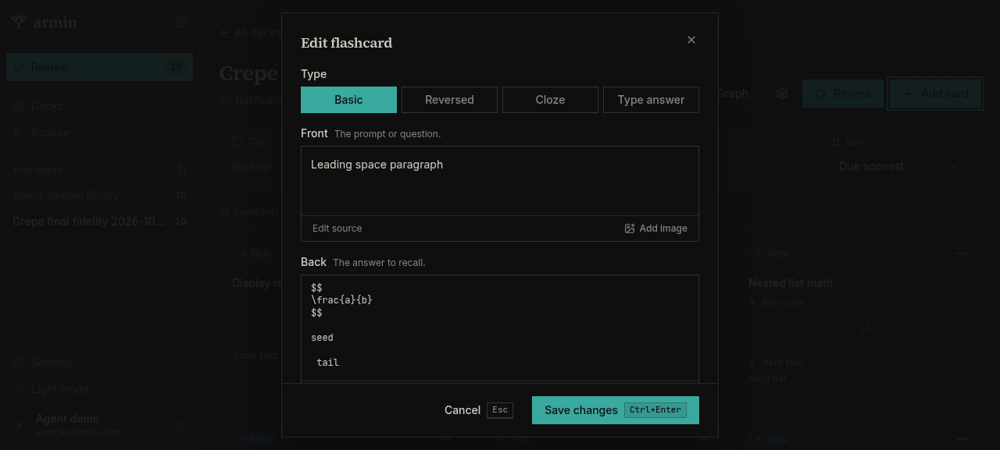

# Milkdown Crepe fidelity re-check — 2026-10-27

Re-tested the D1–D11 findings in
[2026-10-27-crepe-fidelity.md](2026-10-27-crepe-fidelity.md), plus the newer
normalization, upload-race, leading-space, entity/code, and typography changes,
against the current uncommitted code in the shared checkout:

- Branch `t3/evaluate-tiptap-alternatives`, `HEAD` `b074a2e`
- Web app `http://armin-e10076973e.localhost:12872`
- Sample account `test@example.com` from `.armin/demo-account.json`
- `agent-browser` 0.39.4, dedicated session `crepe-final-fidelity`
- 1280 × 577 viewport, dark mode, desktop Chromium (headless). This is a
  browser walkthrough, not a phone, native app, or production test.
- No application-code edits, commit, push, or sub-agent work. All writes went
  through the UI.

Code under test (SHA-256):

| File | SHA-256 |
| --- | --- |
| `apps/web/src/components/ui/markdown-editor.tsx` | `8a63782d99a35f88d8ddad20d68c41c140c8049bfc2bb00b83efec1930456fde` |
| `apps/web/src/components/ui/markdown-image.ts` | `87598906e16cbb66cd249f06901dd4ee28ed6d336d70ae59197d66cc4b8a41b3` |
| `apps/web/src/lib/image-size.ts` | `1c50c5700f116329a05fb6fa6c4361e29838ee76242bcc5ccc64d3fa8d1469de` |
| `apps/web/src/components/flashcard-form-dialog.tsx` | `a510fc5e120865fc63f7ec73ccd60d625c64acad0743dc373ecc0d02c9ffd023` |
| `apps/web/src/styles/app.css` | `8b2b2efc23b7af9d7f0d15a86eabb854cf2330683ef47590e0ead6862c4eaab1` |

Stored values were read back with the checkout's local Convex CLI. Upload races
were made deterministic by wrapping the page's `window.fetch` to delay
`POST /media/upload` by 6 seconds. The wrapper was test instrumentation only and
was restored (`window.fetch === window.__qaOrigFetch`) before the session ended.

## Verdict

| # | Prior defect | Current result |
| --- | --- | --- |
| D1 | Display math in a table is moved out and corrupts the table | **Fixed** by lossless source fallback; the table row and `$$…$$` survive a source edit and save unchanged. |
| D2 | A second image replaces the first | **Fixed**; two consecutive uploads and a multi-file selection both keep all images. |
| D3 | In-flight upload is dropped on source switch or save | **Fixed**; footer submit, Ctrl+Enter, and Edit source are blocked while uploads are pending, and the image lands afterwards. |
| D4 | Source-mode upload repopulates the next card with the old body | **Fixed**; pending saves are blocked and the unmount guard prevents stale callback writes. |
| D5 | Ordinary currency renders as inline math | **Partial**; currency-only text now opens in lossless source mode, but currency mixed with real Armin math still renders the currency as a Crepe math atom. |
| D6 | Multi-line display math accumulates blank lines on every edit | **Fixed**; TeX is trimmed and stayed stable across three rich edits. |
| D7 | A fenced `latex` code block becomes display math | **Fixed**; `latex` fences open and save in lossless source mode. |
| D8 | Display math in a list splits the list | **Fixed** by lossless source fallback; list markers and rows survive a save. |
| D9 | Display math in a sentence splits the paragraph | **Fixed** by lossless source fallback; the sentence opens as one source string with a rendered preview. |
| D10 | Code spans and autolinks are treated as HTML and forced to source | **Fixed**; code spans, code fences containing tags, and autolinks open visually. |
| D11 | Source-mode image insertion loses the caret | **Fixed**; focus and caret are restored after each insert and images are placed consecutively. |
| — | Leading space emitted as `&#x20;` | **Fixed** for newly emitted text; a leading space is stored as a real space. Old entities display as spaces; code entities stay literal. |
| — | Editor font stayed at 16 px | **Fixed**; computed `.ProseMirror` font-size is 14 px, line-height 22.75 px. |
| — | Empty first paragraph emitted raw HTML | **New confirmed issue**; pressing Enter at the start of an empty visual field stores `<br />` and forces the field into source mode on reopen. |

## Evidence

### D1 — table display math

Created a card with Back:

```markdown
| A | B |
| --- | --- |
| 1 | $$y^2$$ |
```

Reopening opened the Back in **source mode**, textarea value exactly the stored
string. The source preview rendered one `.katex-display` node. I appended a
prose line through the source textarea and saved; the stored value became:

```markdown
| A | B |
| --- | --- |
| 1 | $$y^2$$ |

Edited table.
```

The table row and `$$y^2$$` were unchanged. Escape without editing showed no
`Discard changes?` prompt. This confirms the D1 corruption path is closed by
refusing visual editing for display math nested in a table.



### D2 — consecutive and multi-file images

`Images consecutive`: Back `Body`; two separate **Add image** actions with no
click into the editor between them. The editor showed two
`.card-editor-image img` nodes, and **Edit source** contained both references:

```markdown
Body


```

The saved card preserved both. `Images multiselect` uploaded both files in one
file-input change; it also showed two images and emitted two references. The
selection is moved past each inserted image before the next insert.



### D3/D4 — upload races and stale callbacks

Instrumentation: `/media/upload` delayed by 6,000 ms. This is the same harness
as the earlier report; it is not application code.

**Rich-mode upload.** With an upload pending, the editor showed
`Uploading image…`; **Edit source** and the footer **Add card** (create mode)
were disabled. The edit-mode **Save changes** button uses the same `canSubmit`
gate (`uploads === 0`). A real Ctrl+Enter at that moment did not close the
dialog or create a card. After the upload finished, the image appeared, both
controls re-enabled, and the card saved with the image.

**Source-mode upload.** With the Back in source mode and the upload pending, the
footer **Add card** was disabled and Ctrl+Enter did not submit. After
completion the image was inserted at the source caret and the card saved with
both references.



**Unmount / stale callback.** Created a draft with Back source `OLD BODY`,
started a delayed upload, then escaped and chose **Discard changes**. After the
upload completed, a toast appeared:

> Image not added — The card editor was closed before the upload completed.

Reopening **Add card** showed empty Front and Back fields, no image, and no
`OLD BODY`. No card was created. The old mounted-editor callback did not write
into the new draft. The upload still completed server-side; the editor reported
it instead of silently dropping it.

### D5 — currency

**Currency-only string.** Back `Price is $5 and $10 today.` reopened in
**source mode** with that exact value. There was no KaTeX node and no dirty
prompt. This fixes the original D5 reproduction.

**Currency plus real math.** Back
`Price is $5 and $10 today. Inline $x^2$ works.` reopened in the **visual**
editor. Crepe still created an inline math atom for currency
(`data-type="math_inline"`, `data-value="5 and "`) next to the real `x^2`
atom, exactly the D5 symptom. The stored string round-tripped unchanged after
an edit and save:

```markdown
Price is $5 and $10 today. Inline $x^2$ works.!
```

So this is still a display/editability mismatch, not text loss: Crepe's
remark-math ignores Armin's currency guard whenever the field also contains
real Armin math. The source fallback only covers currency when the whole field
has no Armin math.



### D6 — repeated standalone display math edits

Created Back from source with extra blank lines:

```markdown
$$

\frac{a}{b}

$$

Body text.
```

The first rich edit normalized it to:

```markdown
$$
\frac{a}{b}
$$

Body text.!
```

After a second and third rich edit of the prose, the stored value was stable:

```markdown
$$
\frac{a}{b}
$$

Body text.!23
```

No blank lines were added inside the delimiters. The editor reopened visually
(the math is represented as a `<pre data-language="LaTeX">` block), and the deck
tile still had exactly one `.katex-display` node. TeX trimming works as
intended.



### D7, D8, D9 — lossless source fallback

- **D7:** Back opened source-mode with exactly
  ` ```latex\n\frac{a}{b}\n``` `. Appending `\n\nKept.` and saving stored
  the same fence and language, with no conversion to `$$…$$`. Reopening was
  still source mode.
- **D8:** `- item one $$x^2$$\n- item two` opened in source mode, textarea exact,
  preview had one `.katex-display`. Appending `\n\nKept list.` and saving kept
  the `-` markers, list items, and inline `$$x^2$$`.
- **D9:** `Before $$x^2$$ after.` opened in source mode, textarea exact, one
  `.katex-display` in the preview, no dirty prompt on Escape. I did not save an
  edited version of this card, but the source save path is the same one
  exercised in D7/D8.

This is a deliberate data-preservation trade-off: these cards are now
source-only in the editor. The previous corruption/splitting is gone, but there
is no control back to visual editing.

### D10 — code spans, code fences, autolinks

- **Code span with tags:** `` `a<b && c>d` returns true. `` opened visually.
  The DOM was `<p><code>a&lt;b &amp;&amp; c&gt;d</code> returns true.</p>`.
  Adding `!` at the end and saving stored
  `` `a<b && c>d` returns true.! `` — the code content, `<`, and `&&` were
  unchanged.
- **Code fence with tags:** ` ```html\n<div>hi</div>\n``` ` opened visually as
  a code block with `data-language="html"` and code text `<div>hi</div>`.
  Adding `!` inside the block and saving preserved the fence and language:
  ` ```html\n<div>hi</div>!\n``` `.
- **Autolink:** `<https://example.com>` opened visually as an anchor with
  `href="https://example.com"`. Adding `!` at the end while the caret was inside
  the link normalized the source to
  `[https://example.com!](https://example.com)`; the link and text remained
  semantically correct, but the autolink syntax was rewritten. This is a
  normalization note, not lost content.





### D11 — source-mode caret and insertion

Back source was `ABCDE` with the caret at offset 2. After the first upload:

```text
ABCDE
selectionStart = 102, selectionEnd = 102, focused = true
```

After the second upload:

```text
ABCDE
selectionStart = 203, selectionEnd = 203, focused = true
```

The second image was inserted immediately after the first, at the restored
caret, not at the start or end of the field. The saved card contained both
references in that order.



### Leading spaces and entities

- **Field-leading space:** typing a space then `tail` in an empty visual Front
  produced source ` tail\n` (a real leading space, not `&#x20;`). Saving
  trimmed the field-leading space to `tail`, matching the existing
  `contentFromFields` trim.
- **Paragraph-leading space:** after a standalone display equation and a
  `seed` paragraph, pressing Enter and typing ` tail` produced:

  ```markdown
  $$
  \frac{a}{b}
  $$

  seed

   tail
  ```

  The stored value kept the real space. No `&#x20;` appeared in the DOM or
  page text.
- **Old entity fixture:** `Crepe fidelity I: image` (Back contains
  `&#x20;Extra text.`) opened visually and displayed ` Extra text.`; the entity
  was decoded to a space, not shown literally. I opened it and escaped without
  saving it.
- **Prose entity:** source `A &amp; B and &#x20; entity.` opened visually as
  `A & B and   entity.` and saved in that decoded form. This is a byte change
  but semantically equivalent. **Code-span entities stayed literal**:
  `` `&#x20;` and `&amp;` literal in code. `` reopened visually with both code
  spans unchanged, and an edit/save stored them unchanged.



### Computed font and theme

Empty Add card, dark mode, computed values in both card editors:

- `.ProseMirror`: `font-size: 14px`, `line-height: 22.75px`,
  `font-family: "Inter Variable", Inter, …`, `padding: 0px`.
- `.milkdown`: `font-size: 14px`, transparent background,
  `color: rgb(206, 205, 195)`.
- The `text-sm` wrapper was also `14px` / `22.75px`.

This fixes the residual 16 px typography note from the earlier re-check.
Light-mode typography was not re-measured.

### New confirmed issue — Enter at the start of an empty field stores `<br />`

This was not one of D1–D11.

Reproduction:

1. Open **Add card** with an empty visual Front.
2. Press Enter, then type `x`.
3. Click **Edit source**.

Actual textarea value:

```html
<br />

x
```

After saving, the stored Front was `<br />\n\nx`. Reopening the card opened the
Front in **source mode** with that raw HTML; the card label was `<br /> x`.
The empty first paragraph had been serialized as a raw HTML line break, which
then trips `needsSourceMode()` on the next open.

This happened twice (once accidentally and once in a controlled reproduction).
It is a real data-fidelity/UX defect: Enter at the start of a new field is a
normal action, and it makes the field source-only afterwards. The Back field
and visual editing of other content were unaffected.


## Console and coverage notes

- `agent-browser errors` reported no page errors.
- Console output was limited to Vite connection messages, the React DevTools
  development message, and Milkdown's bundled Vue esm-bundler feature-flag
  warning. No new application warnings appeared during the upload or
  source-fallback tests.
- I did not exercise a physical phone, native client, light-mode typography,
  paste/drop upload, image drag/reorder, image zoom, undo/redo, IME
  composition, the inline-math edit tooltip, export/import, Anki-imported
  formatting, or a full review session.
- I did not run `pnpm check`, the web build, or the mobile bundle check. No new
  automated tests were added, per repository policy.
- Findings are local-deployment browser observations; they do not establish
  production behaviour.

## Cleanup and demo data

- Created a temporary deck, `Crepe final fidelity 2026-10-27`, for destructive
  tests. All 20 test cards were removed by deleting the deck through the UI;
  the local database confirms zero cards remain in that deck. The sample
  library still has its 25 cards, unchanged.
- The prior `Crepe fidelity I: image` fixture was opened read-only (visual mode)
  and closed with Escape; no sample card was saved over.
- Ten upload requests were made during the image/race tests. The two unique
  files deduplicated to two media rows, which remain orphaned after the temp
  deck was deleted because the UI has no delete action for them; they still
  count against the local library's media quota:
  - `md750dxn3pr5gt2xc5xcepyw9x8h38br` — `5d18de6f…png`
  - `md717ad0x93wjb5f6hrs7jzcj58h2139` — `336f44b4…png`
- The delayed-fetch test wrapper was removed from the page before the browser
  session closed. No application source, lockfile, route file, or generated
  backend file was changed by this run.

## Bottom line

D1–D4 and D6–D11 are fixed in the current build, including the media races,
multiple-image insertion, standalone display-math stability, lossless source
fallback, code-span/autolink editing, and source-caret restoration. The
remaining confirmed fidelity gap is D5 for a field that mixes currency with real
Armin math; currency-only text is handled. A new medium issue is the raw
`<br />` emitted for an empty first paragraph, which forces the field into
source mode on the next open. Leading spaces now store as real spaces, old
entities display as spaces, and code-span entities stay literal.
