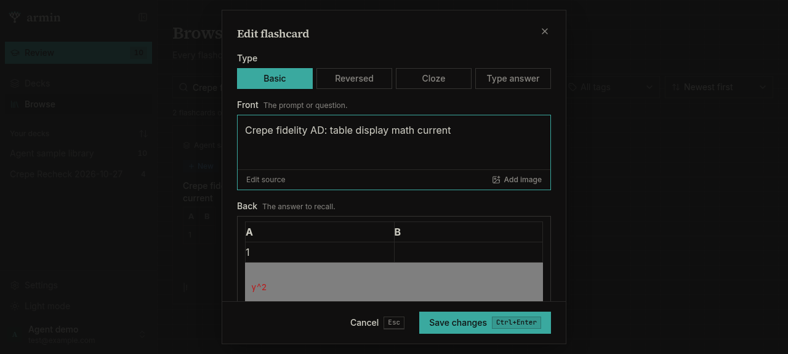
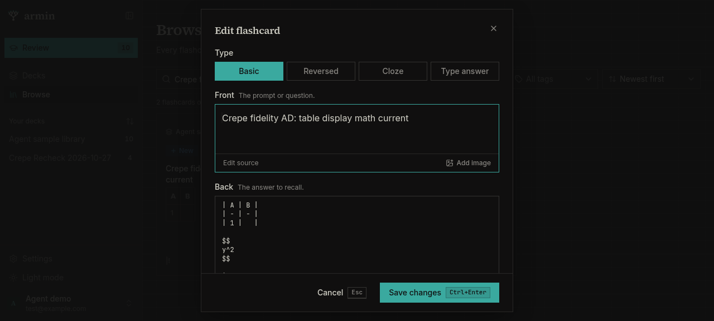

# Milkdown Crepe card editor fidelity walkthrough

Date: 2026-10-27
Area: card Markdown authoring (`apps/web/src/components/ui/markdown-editor.tsx`,
`apps/web/src/components/ui/markdown-image.ts`, `apps/web/src/lib/image-size.ts`)
Branch: `t3/evaluate-tiptap-alternatives`
Checkout: `/home/andy-spike/.t3/worktrees/armin/t3-98b4d733` (shared with another tester)
Web app: `http://armin-e10076973e.localhost:12872`, local Convex deployment, sample account
`test@example.com` from `.armin/demo-account.json`
Browser: agent-browser managed Chromium, session `crepe-fidelity-68cdc0a5c5d8`, desktop viewport.
No Playwright, no application-code edits, no commit, no PR work.
Read before starting: `AGENTS.md`, `README.md`, `docs/dev-worktrees.md`,
`/home/andy-spike/.agents/browser-policy.md`, and the agent-browser core/dogfood skills.

Build under test: working tree at `HEAD` `b074a2e`. The dev server hot-reloaded
`markdown-editor.tsx` during the walkthrough (16:54:28). Final code hashes:

| File | SHA-256 |
| --- | --- |
| `markdown-editor.tsx` | `47402e633a900f8358c802f8f7a0c386568698817a1b025961d6a16e3cece071` |
| `markdown-image.ts` | `87598906e16cbb66cd249f06901dd4ee28ed6d336d70ae59197d66cc4b8a41b3` |
| `image-size.ts` | `1c50c5700f116329a05fb6fa6c4361e29838ee76242bcc5ccc64d3fa8d1469de` |

Findings are labelled **current build** when they were re-run after that reload.
Two findings from the earlier build were rechecked and are fixed in the current build;
they are listed separately so they are not mistaken for current defects.

Raw stored values were read with the checkout's dev Convex CLI
(`pnpm exec convex data flashcards --format json`); all writes went through the UI.
The worktree is shared, so another tester's decks and cards appeared while this ran.
I only touched cards whose front starts with `Crepe fidelity`.

## Defects (current build)

### D1. High: display math inside a table is moved out of the table and the table is corrupted on the next back edit

Reproduction:

1. Add a basic card. Front: `Crepe fidelity AD: table display math current`.
2. Open **Back → Edit source** and enter:

   ```markdown
   | A | B |
   | --- | --- |
   | 1 | $$y^2$$ |
   ```

3. Save, close, then reopen the card.
4. The editor shows a table whose second cell is empty, followed by a separate
   LaTeX code block for `y^2`:

   

5. Type one character in the back field, click **Edit source**, and click
   **Save changes**.

Actual stored value after saving that edit (verified in Convex, v2):

```markdown
| A | B |
| - | - |
| 1 |   |

$$
y^2
$$

|!
```

The math was pulled out of the row, the `B` cell became empty, and the closing
`|` became its own paragraph:



The original v1 record was still intact. Opening the card and pressing
**Cancel** without editing the back did not write anything; the corruption is
committed by the next back-field edit (the form still holds the original
`value` until the editor dispatches a change).

Cause: `editorMarkdown()` (`markdown-editor.tsx:54-62`) runs `splitMath()` over
the whole field and replaces every display-math part with
`\n\n$$\n${part.tex}\n$$\n\n`, without knowing whether the part is a table
cell, list item, blockquote, or inline text. In a GFM table, those newlines end
the row.

This is the most direct data-preservation failure found: a supported construct
(GFM table + `$$` display equation) is silently rewritten when the card is
edited.

### D2. High: adding a second image replaces the first image

Reproduction A (two Add image actions):

1. Add a card, put the caret in the back field, and click **Add image**, choosing
   `fidelity-diagram.png`. After it uploads the editor shows one image.
2. Without clicking back into the text, click **Add image** again and choose
   `fidelity-diagram-2.png`.
3. The editor now shows only `fidelity-diagram-2.png`; the first image is gone.
   Switching to **Edit source** shows only the second image:

   ```markdown
   
   ```

Reproduction B (multi-select): selecting both files at once in the file picker
also leaves only the last image in the Markdown.

Workaround: after the first image, click inside the trailing paragraph with a
real mouse click, then add the second image. Both images then remain. This
points at the current ProseMirror selection: the inserted image block is still
selected after upload, and `insert()` inserts into/replaces that selection.
`insertImages()` (`markdown-editor.tsx:196-215`) never moves the selection
between files.

The previous editor is recorded as having a card with two uploaded images in
`docs/qa/2026-10-27-react-lint-warnings.md` ("[Image 1]" and "[Image 2]"), so
two-image cards were supported before; I did not re-run the old editor to prove
the exact old insertion behavior.

### D3. High: an in-flight image upload is silently dropped on source switch or save

Test instrumentation: the page's `window.fetch` was temporarily wrapped to delay
`POST /media/upload` by 6 seconds, so the race is deterministic. The wrapper was
restored after each test; it is test instrumentation only, not app code.

**D3a: switching to source while the upload is pending.**

1. Add a card, type `Body` in the rich back field.
2. Delay `/media/upload`, choose an image, and immediately click **Edit source**.
3. Wait for the upload to finish.

Actual: the source textarea contains only `Body`; the image never appears, and
no toast is shown. The upload request returned 200. The `insertImages()`
continuation checks `source` from the render that started the upload and then
finds `crepeRef.current === null` because the editor was destroyed.

**D3b: saving while the upload is pending in rich mode.**

1. Add a card with front `Crepe fidelity X: save during upload` and back `Body`.
2. Delay `/media/upload`, choose an image, and immediately click **Add card**.
3. The card saves with back `Body` only; the media table gained a row for the
   uploaded file. No image appears in the saved card, the reset editor, or a
   toast.

Impact: a slow upload loses the user's action, leaves an orphaned media row
(counting against the library's media quota), and reports nothing.

### D4. High: saving during a source-mode upload injects the previous card's body into the next card

This is the source-mode variant of D3 and is worse than a dropped image.

1. Add a card with front `Crepe fidelity Y: source save during upload` and back
   source `OLD BODY`.
2. Delay `/media/upload`, choose `fidelity-diagram-2.png` in the back's
   **Add image** while in source mode, and immediately click **Add card**.
3. The saved card has back `OLD BODY` (verified in Convex).
4. The dialog resets for the next card, but after the delayed upload finishes
   the new empty card's back editor contains `OLD BODY` again plus the uploaded
   image. No toast is shown.

Cause: the source branch of `insertImages()` (`markdown-editor.tsx:203-207`)
calls `latest.current.onChange(...)` after the await. `latest` is a ref owned by
the old mounted editor, but the closure keeps it alive. When create mode resets
the fields and remounts the editors, that old callback still writes into the
shared form state, repopulating the new draft with the previous card's content.
There is no disposed/alive guard.

Impact: the next card can be saved with stale content and an image from the
previous card, producing duplicate or wrong cards.

### D5. Medium: ordinary currency is rendered as inline math in the editor

Reproduction:

1. Create a card with back `Price is $5 and $10 today.`
2. Reopen it. Crepe creates an inline math atom whose `data-value` is `5 and `
   (the closing `$` is immediately before `10`), so the editor shows italic math
   for "5 and" instead of ordinary prose.
3. The read-only renderer does not do this: `@armin/core/math` rejects the
   closer because it is followed by a digit, so the card renders as currency
   text.
4. The stored string round-trips unchanged on save (`Price is $5 and $10
   today.`), so this is a display/editability mismatch, not yet a text loss.

Cause: Crepe's `remark-math` does not use Armin's currency guard, and
`needsSourceMode()` does not force currency-looking text into source. The editor
renders it as math while the read-only renderer does not.

Editing hazard: the currency fragment is an atom; placing a caret inside it and
using the inline-math editor changes it as TeX, not prose. A user trying to edit
the sentence can unintentionally turn currency into an equation.

### D6. Medium: multi-line display math accumulates blank lines on every rich edit

Reproduction:

1. Card back starts with the common stored form:

   ```markdown
   $$
   \frac{a}{b}
   $$
   ```

2. Edit any prose in the back and save. The stored value becomes:

   ```markdown
   $$

   \frac{a}{b}

   $$
   ```

3. Reopen, edit any prose again, and read source: it is now

   ```markdown
   $$


   \frac{a}{b}


   $$
   ```

Each rich edit adds one blank line on each side of the TeX. The equation still
renders, but the stored source drifts every time. The same growth starts on the
second edit of a card that originally used single-line `$$...$$`.

Cause: `editorMarkdown()` wraps `part.tex` without trimming it. `splitMath()`
returns the TeX including the newlines that are already inside the delimiters,
so `\n\n$$\n${part.tex}\n$$\n\n` adds another pair each time.

### D7. Medium: a fenced `latex` code block becomes display math on the next edit

Reproduction:

1. Create a card with back:

   ````markdown
   ```latex
   \frac{a}{b}
   ```
   ````

2. Reopen it; the editor shows a code block with language `latex`.
3. Type one character in the block and switch to **Edit source**.

Actual source:

```markdown
$$
\frac{a}{b}!
$$
```

The code fence and its language are gone; the block is now display math. Crepe's
`blockLatexSchema` serializes any code block whose language is `latex` as a
`math` node (the same mechanism it uses internally to store display math).
`needsSourceMode()` does not catch a `latex` fence. If a card intentionally
shows LaTeX source as code, it changes type on the next edit. If this conversion
is intentional for math authoring, it still needs to be documented and should
not apply to a user-authored `latex` code sample.

### D8. Medium: display math inside a list item splits the list

Reproduction: back source

```markdown
- item one $$x^2$$
- item two
```

Opening it produces two separate bullet lists with a display-math block between
them. Editing and saving (v2) produces:

```markdown
* item one

$$
x^2
$$

* item two!
```

The text and equation survive, but one list becomes two and the bullet marker
changes. Same `editorMarkdown()` cause as D1.

### D9. Low/Medium: display math inside a sentence is split into separate paragraphs

Reproduction: back `Before $$x^2$$ after.`

The editor DOM is `p "Before"`, a LaTeX code block, `p "after."` instead of one
sentence. The same `editorMarkdown()` wrapping that D1 and D8 saved would
serialize this block form on the next back edit, so the sentence structure
changes. I did not save an AC edit; the visual split was observed on open and the
serializer behavior is confirmed by D1/D8. Display math is normally block-level,
but a card that previously wrote it inline in prose no longer round-trips as one
paragraph.

### D10. Low: the source fallback treats code spans and autolinks as HTML

Reproduction: create a card with back `` `a<b && c>d` returns true. `` and
reopen it. The back opens in **source mode** (a textarea), so the card cannot be
edited visually even though the content is a normal code span.

`needsSourceMode()` (`markdown-editor.tsx:51`) is
`/<\/?[a-z][^>]*>|\\\([\s\S]*?\\\)|\\\[[\s\S]*?\\\]|\[(?:\$|latex)/i`. The
`<b && c>` substring matches the HTML-tag branch. The same regex would also
match `<https://example.com>` autolinks and code fences containing tags (I
tested the code-span case only). Data is preserved (source mode is lossless),
but rich editing is lost and source mode is one-way.

### D11. Low: adding images in source mode does not keep the caret after the inserted image

Observed while testing D3/D4 in source mode: with the source textarea not
focused, the first **Add image** inserted at offset 0, and the second inserted at
the end of the field, rather than consecutively at the intended caret. The old
plain-text insertion helper restored the caret after each snippet; the current
source branch of `insertImages()` (`markdown-editor.tsx:203-207`) only calls
`onChange` and does not restore focus/selection. This is cosmetic compared with
D2-D4, but makes multi-image authoring in source unpredictable.

## Earlier-build findings rechecked on the current build

The first half of this walkthrough ran before the 16:54:28 hot reload. These were
real on that build and are fixed in the current build; they are listed so the
same symptoms are not re-reported against the current code.

- **False "Discard changes?" on open.** On the earlier build, opening a card
  ending in a table, list, or display-math block and pressing **Cancel** showed
  the discard prompt without any user edit, because the editor emitted a
  normalized Markdown value after load. Current build: cards D (table only), O
  (list and code), and AB (single-line display math) all closed with **Cancel**
  without a prompt.
- **Single-line `$$x$$` became inline `$x$`.** On the earlier build, a card with
  `$$\frac{a}{b}$$` became `$\frac{a}{b}$` after an edit. Current build:
  `editorMarkdown()` converts it to a display block, and the edited source is
  `$$\n\frac{a}{b}\n$$`; display semantics are preserved. (The first test card
  `Crepe fidelity P` still holds the old `$\frac{a}{b}$!` record because it was
  saved before the fix.)

## Checks that passed

| Area | Steps | Result |
| --- | --- | --- |
| Mixed GFM round trip | Card B saved from source, reopened, edited, reopened | Table with alignment and escaped pipe, ordered list starting at 3, nested bullets, task list, fenced `js` code with `$not math$`, link, strikethrough and inline `$x^2$` all survived; editing normalized table padding and `-` bullets to `*` (semantically equivalent). |
| Source fallback: HTML | Card A with `<br>` in a table cell | Opened in source mode; v1 stored string matched input exactly after save/reopen. |
| Source fallback: legacy math | Card L with `\(x^2\)`, `\[x^2\]`, `[$]y[/$]`, `[$$]z[/$$]`, `[latex]…[/latex]`, `<mark>` | Opened in source mode; stored string matched exactly; the source preview rendered four KaTeX nodes. `[latex]` remained literal text with no warning (pre-existing behavior, see observations). |
| Currency string | Card C `Price is $5 and $10 today.` | Stored string round-tripped exactly; see D5 for the editor's math rendering mismatch. |
| Single-line display math | Card AB `$$\frac{a}{b}$$` | Current build opens it as a display block and stores `$$\n\frac{a}{b}\n$$` after an edit; display semantics preserved. |
| Chemistry | Card N `Water is $\ce{H2O}$ and $\alpha$.` | `\ce{H2O}` rendered as chemistry and `\alpha` rendered; stored source unchanged. |
| Image upload and refs | Card I, Add image in rich mode | Uploaded through the dialog; editor shows `/media/<hash>.png`; emitted Markdown uses `armin-media:<hash>.png`. |
| Image alt, caption, width | Card I, source edit ``, reopen, move slider to 520 | Editor shows alt `A blue gradient diagram`, title `Figure caption`, width `480px`; slider shows 480. Moving the slider emitted `"w=520 Figure caption"` with alt and caption intact. |
| Image error handling | SVG upload; 11 MB PNG upload | SVG rejected with "Use a PNG, JPG, GIF, WebP, BMP, or AVIF image."; oversized file rejected with the size message. No Markdown was inserted. |
| Image upload in source mode | Card K source back; Add image | Emitted `` at the source caret; no file picker regression. |
| Source upload insertion | Card AK source back; two sequential Add image actions | Both images were inserted (unlike rich mode, see D2), but the caret placement was scattered (D11). |
| Plain text | Card E | No false dirty prompt on open/cancel. |
| Table/code/list formatting | Cards B, D, O | Rich editing normalizes table padding, bullet markers, and adds a trailing newline in the editor state; basic-card save trims the trailing newline. No semantic content loss found outside D1/D8/D9. |
| Console | Whole session | No page errors. One dev-only Vue esm-bundler warning (see observations). |

## Observations, risks, and hypotheses

Clearly separated from the reproduced defects above:

- **Caption and alt authoring:** the custom image node view (`markdown-image.ts:41-97`)
  has no caption or alt inputs. Captions are only visible as the `title` tooltip
  and can only be authored in source mode. The previous editor also had no
  caption UI, so this is not a regression, but Crepe's default image block UI
  would have provided one. `markdown-image.ts` overwrites `nodeViews["image-block"]`
  with its own `div/img/range/button`, so the caption editor is intentionally
  suppressed.
- **Width slider limit:** the range is hard-coded `min=48` / `max=1200`
  (`markdown-image.ts:55-57`). A stored width above 1200 (possible via source or
  old data) is displayed by `img.style.width` but the range clamps its value to
  1200; the first slider interaction would shrink the stored width. Hypothesis,
  not exercised.
- **Paste/drop alt:** Crepe's upload plugin creates image nodes with only
  `src`; `insertImages()` sets `alt` to the filename, but a pasted/dropped file
  likely gets an empty alt. Hypothesis from reading
  `@milkdown/crepe`'s uploader; I did not paste/drop a file.
- **`editorMarkdown()` class:** the same `splitMath()` wrapping that corrupts
  tables/lists would also affect display math inside blockquotes, headings, or
  image titles/captions. Not tested, but the code path is the same.
- **`mhchem` load order:** `\ce` rendered correctly because the read-only deck
  preview had already imported `katex/contrib/mhchem` via
  `@armin/core/math-render`. Crepe's own KaTeX call does not import mhchem. If
  the editor mounts before any read-only math has loaded, a chemistry card could
  show a KaTeX error until the app's math renderer loads. Hypothesis; the
  observed session had the preview loaded first.
- **Custom `dispatchTransaction`:** it calls `view.updateState()` directly
  (`markdown-editor.tsx:141-151`) instead of `view.dispatch()`. State, plugins,
  and the listener still update, but `view.dispatch()`'s scroll-into-view
  behavior is bypassed. A block inserted at the bottom may not scroll to the
  caret. Hypothesis, not observed.
- **Synchronous serialization:** the same handler serializes the whole document
  on every doc-changing transaction, whereas the old listener debounced
  `markdownUpdated` by 200 ms. Large cards may type less smoothly. Hypothesis,
  not measured.
- **IME composition:** emitting Markdown and calling the parent `onChange` on
  every transaction could interfere with composition (CJK input). Not tested.
- **Source mode is one-way:** once a card falls back to source, there is no
  control back to rich editing. This is pre-existing, but the new broader regex
  (D10) sends more cards into that one-way mode.
- **Trailing whitespace/`&#x20;`:** a leading space typed at the start of an
  empty paragraph was serialized as `&#x20;` in the image card. The read-only
  renderer decoded it back to a space; no visible loss. Observation.
- **Image replacement in `insertImages()`:** the rich branch uses
  `insert(resolveMediaRefsInMarkdown(markdown))` after each await. The fix should
  either insert all images in one transaction or place the selection after the
  inserted node; D2 is the user-facing evidence.
- **Unmount guards:** `insertImages()` has none. D3/D4 are the two observed
  consequences; a dialog close during an upload is the same missing guard but
  was not separately reproduced.
- **Read-only image rendering:** storage and the unchanged `MarkdownContent`
  parser were inspected (title `w=<px> caption`, alt preserved), but I did not
  open a Review card to see the image width/caption rendered at full size. Deck
  tiles use `images="placeholder"`, so they cannot verify this.
- **`[latex]` warning:** the README says legacy `[latex]` documents remain
  source with a preview warning; card L showed the literal `[latex]` line with
  no warning. This appears pre-existing, not specific to the Crepe swap.
- **Vue dev warning:** the browser console shows the Vue esm-bundler feature
  flag warning introduced by the Crepe dependency. It is dev-only noise, not a
  page error.
- **Table/list normalization:** editor-driven round trips rewrite table padding
  and `-` bullets to `*`. This is semantically equivalent and no longer marks a
  freshly opened card dirty, but it still changes the stored bytes on the first
  edit. Some tools that diff or hash card source will see churn.

## Not checked

- Native/mobile rendering or a real phone/tablet; this was desktop Chromium only.
- Real network latency and packet loss; D3/D4 used a deterministic 6-second
  `fetch` delay for `/media/upload`.
- Paste/drop of image files, drag-to-reorder images, image deletion, undo/redo,
  IME composition, and the inline-math edit tooltip.
- Export/import round trips, Anki import of tables/math/images through the new
  editor, and backend media quota enforcement after orphaned uploads.
- A full Review pass to see read-only image width/caption on a revealed card.
- Light/dark visual polish, keyboard-only accessibility, and screen-reader
  behavior for the image slider and atom nodes.
- `pnpm check`, the web build, or the mobile bundle check; the implementation
  owner runs those. No new automated test suite was added, per repository policy.

## Demo data left in the local deployment

Created `Crepe fidelity *` demo cards in **Agent sample library** and left them
for inspection. Cards intentionally saved in a normalized or corrupted state for
evidence:

- `Crepe fidelity AD: table display math current` — one v1 original and one v2
  corrupted by D1.
- `Crepe fidelity AE: list display math current` — v2 split by D8.
- `Crepe fidelity C: dollar text` — v2 showing the extra blank lines from D6.
- `Crepe fidelity Y: source save during upload` — saved `OLD BODY`, used for D4.
- `Crepe fidelity X: save during upload` — saved `Body` only, used for D3b.

Other `Crepe fidelity *` cards (A, B, D, E, I, L, M, N, O, P, Q, V, Z, AB, AC)
remain as read-only test fixtures. The async tests also left uploaded
media rows that are not referenced by any card; they count against the local
library's media quota. Delete the `Crepe fidelity *` cards and their media when
they are no longer needed. I did not move or delete the other tester's cards or
decks.
