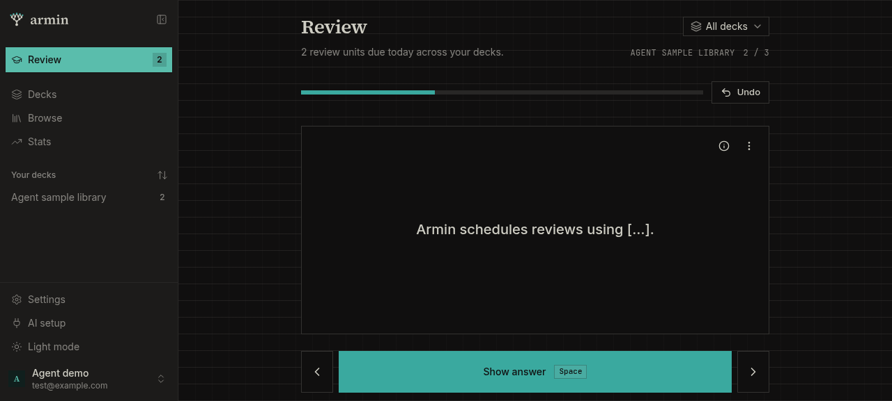
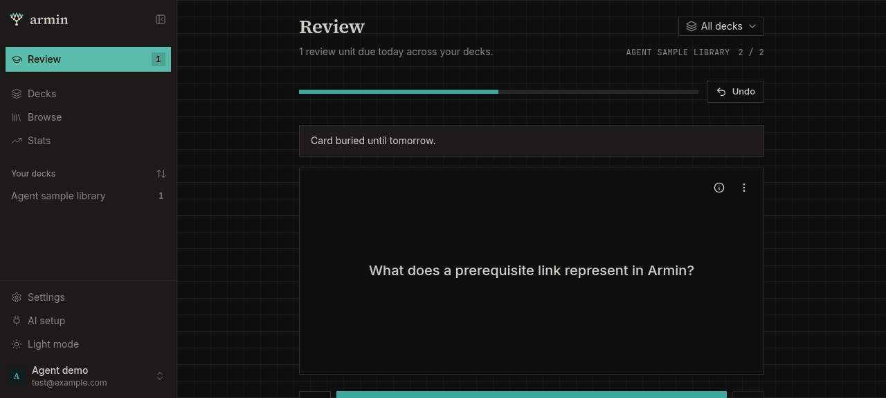
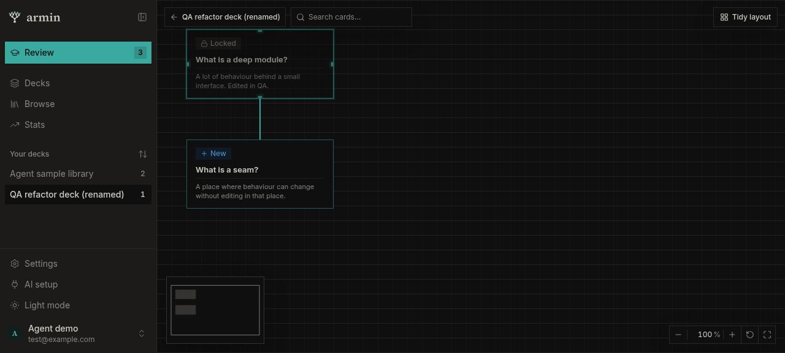
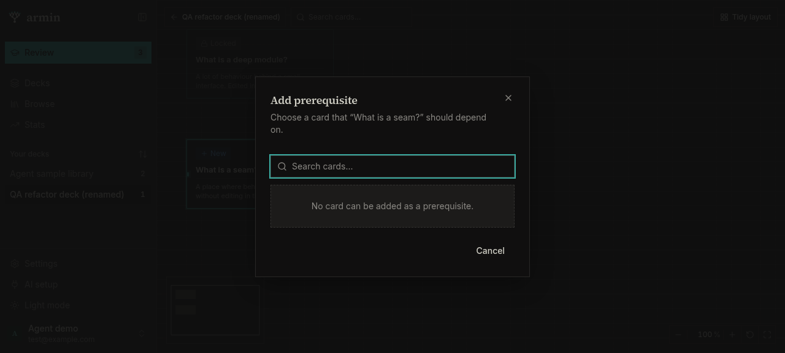
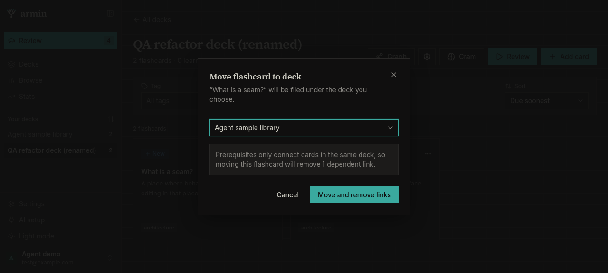
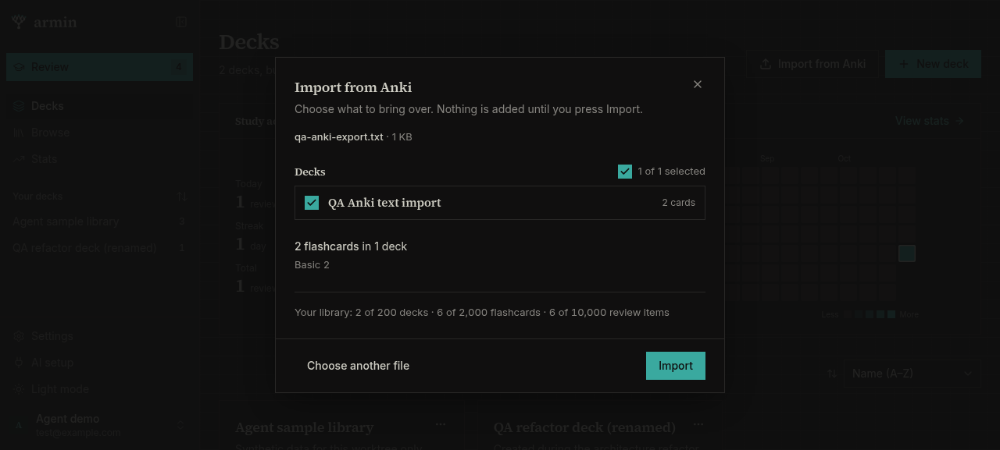

# Architecture deepening walkthrough — 2026-10-28

Scope: the web client, the Convex backend, and the hosted MCP tools in this task
worktree, against its local Convex deployment and `armin-7fa25cf36a.localhost`
origin. The changes were uncommitted. Desktop Chromium (agent-browser, named
session) only; no real phone or mobile runtime was exercised beyond the bundle
check.

## What changed

1. Library capacity: every write that adds decks or flashcards calls
   `checkCapacity` (`model/usage.ts`); five hand-written quota checks and a
   private `reviewUnitTotal` copy are gone.
2. Study writes: edit, archive, move, deck create/rename, and prerequisite
   link/unlink live in `model/flashcards.ts`, `model/decks.ts`, and
   `model/prereqs.ts`. The app's mutations and the assistant tools call them
   after their own checks. Cycle detection is one implementation in
   `@armin/core/prereq-graph`, used by the web canvas and the backend.
3. Assistant writes: request-ID replay and the hourly write limit are one
   `runAgentWrite` wrapper shared by authoring and Anki import tools.
4. Anki reader: moved from `apps/web` to `@armin/core/anki/reader`; the Convex
   benchmark copy and its driver are deleted. Converter kit bumped to 1.0.2
   (the bundle differs only in module paths).
5. Review session: the queue merge, undo history, stale-card, and practice
   repeat rules are a pure engine in `@armin/core/review-session`; the web
   `useReviewSession` hook drives it and keeps the in-order answer outbox.
   Mobile is unchanged.
6. Web client: card info and move-consequence dialogs read live subscriptions;
   two unused live queries and `types/window.ts` (desktop-era naming) are gone.

## Checks

- `pnpm check`: passed (format, lint, types).
- `pnpm --filter @armin/web build`: passed (existing CSS sourcemap warning).
- `pnpm --filter @armin/mobile check:bundle`: passed.
- `pnpm anki:kit:verify`: passed after the 1.0.2 manifest update.
- `pnpm dev` pushed the backend to the local deployment; the regenerated API
  no longer lists the experiment functions.

## Web walkthrough

- Review: interval previews loaded (Again 10m, Hard 15m, Good 2d, Easy 7d).
  Rating **Good** advanced to 2/3 and the due count fell to 2; **Undo** returned
  the same card face-down with an empty answer at 1/3 and restored the count.
  Keyboard reveal (Enter) and rating (3) worked.
  
- Bury: **Bury until tomorrow** removed the card and showed "Card buried until
  tomorrow."; **Undo** showed "Card unburied." and the live queue appended the
  card again (2/3).
  
- Card info opened with the card's units and history (now a live query).
- Decks: **New deck** with a space-padded name created "QA refactor deck"
  (trimmed); **Rename deck** saved. Two cards added, one edited (back text and
  tag saved).
- Graph: adding "What is a seam?" as a prerequisite locked "What is a deep
  module?". The reverse link offered no candidates ("No card can be added as a
  prerequisite."). Removing the link unlocked the dependent; re-linking left it
  unlocked, as expected by the unlock-once rule (ADR 0021).
  
  
- Move: the dialog read "moving this flashcard will remove 1 dependent link";
  **Move and remove links** moved the card and the deck's prerequisite rows
  dropped to zero.
  
- Archive and unarchive updated the deck summary (0 flashcards · 1 archived,
  then 1 flashcard).
- Cram (frozen membership, practice repeat): a four-card session; **Again**
  added a repeat later in the session (2/5, still "4 cards left"); **Undo**
  removed the repeat and returned to the original card at 1/4.
- Anki import: a tab-separated Anki text export previewed 2 Basic cards in 1
  deck with "6 of 2,000 flashcards" from the shared usage query, then imported.
  

- Follow-up fix: the server log showed `moveConsequences` subscriptions with an
  empty card ID from closed move dialogs. Both dialog queries now pass Convex's
  `"skip"` while closed. After a clean restart, the deck page, move dialog
  (no links: **Move flashcard**), and card info loaded with no validation
  errors in the server log.

## Assistant tools (local OAuth probe)

A temporary script outside the repository registered a loopback OAuth client,
was approved on the real consent page in the signed-in browser, exchanged the
code, and called the MCP tools over HTTP. Results:

- `save_cards` (new deck, two cards, one link): created; the same input with
  the same request ID replayed the first result; changed input with that ID was
  rejected.
- A batch whose links form a cycle, and `set_prerequisite` for the reverse
  link: both rejected with "That link would create a cycle in the prerequisite
  graph."; the batch created nothing.
- `move_card` on a linked card: refused. After `set_prerequisite`
  (`present: false`), the move succeeded.
- `update_card` (text and tags), `set_card_archived`, and `update_deck`
  succeeded; a stale `expectedVersion` returned `CONFLICT`.
- `agentActivity` recorded the six successful writes; the hourly write bucket
  counted 6 (replays and rejected writes did not count).

The probe is a local HTTP client, not Claude, ChatGPT, or Codex.

## Not covered

- Beta-limit rejections (`QUOTA`) were not reached at runtime; the shared check
  was reviewed in source only.
- A rejected or retried rating in the review outbox (offline, stale), and a
  card changed in another tab mid-review, were not re-run after the engine
  extraction; that code moved without behavioural edits.
- Browser `.apkg`/`.colpkg` packages and the converter kit CLI on a real
  package were not exercised.

## Readability pass

Behaviour-preserving restructuring after the refactor above:

- `routes/_app/settings.tsx`: the 420-line page is now the tab shell, a
  `useSchedulingSettings` hook (load, autosave queue, presets), and
  `SchedulingTab` / `AppearanceTab`. All labels, hints, and copy are identical
  to `HEAD` (checked by diffing every string attribute and text node).
- Deck and Browse share `useFlashcardTileActions` (move, card info, archive,
  delete confirmation); the review screen and grids share
  `DeleteConsequencesList`.
- `model/queue.ts`: one `isStudyable` rule instead of two copies; the budget
  arithmetic relies on `Infinity` instead of special-casing it.
- `agentImports.materializeNext`: split into `assertStillAuthorized`,
  `publishStagingDecks`, and `writeCardBatch`.
- `@armin/core/anki` converter: `groupBy`, `renderCustomNotetypeCards`, and
  `omissionReason` extracted. A temporary script compared the `HEAD` and new
  converters on a hand-built collection (basic, reversed, cloze, custom
  template, missing note type, audio-only, missing image, trimmed tags) for
  four option sets: all four plans were byte-identical. Kit bumped to 1.0.3
  because the bundled source changed.
- `settings.ts` range checks and the Anki dialog's limit messages got named
  helpers.

Walkthrough after the pass (clean `pnpm dev`, Chromium): Settings loaded
server values; toggling fuzz autosaved, survived a reload, and showed the
per-field and whole-preset reset; reset restored Balanced; Custom → fill from
Aggressive set retention to 95; Balanced restored 90. Deck page: delete dialog
listed "0 dependents…" and "No review history…", **Archive instead** archived,
**Unarchive** restored, card info opened. Browse: card menu and move dialog
opened. Review: 7 due, matching the sidebar. No validation or runtime errors
in the server log.

Not exercised: the assistant staged-import materialization at runtime
(`writeCardBatch` / `publishStagingDecks` were moved without edits).
