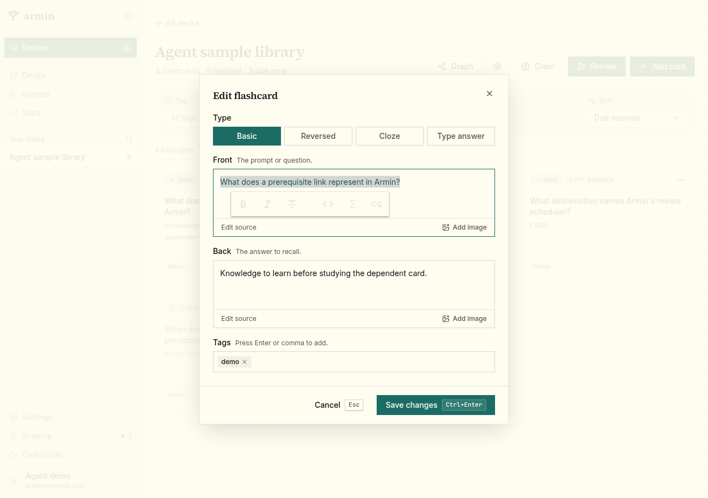
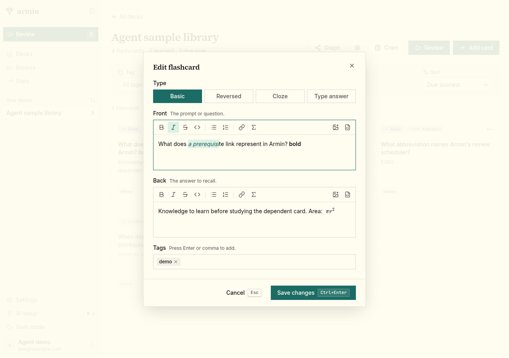
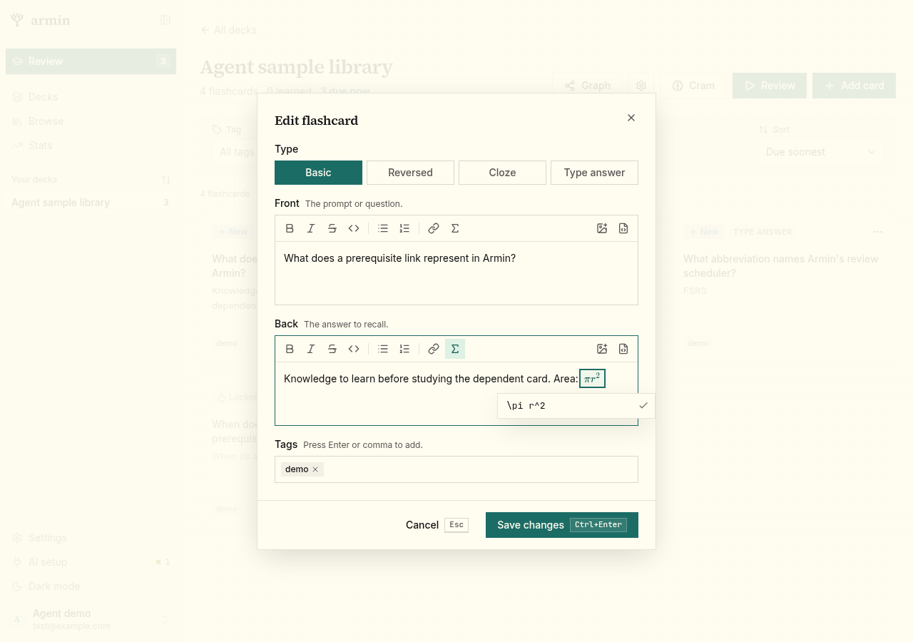
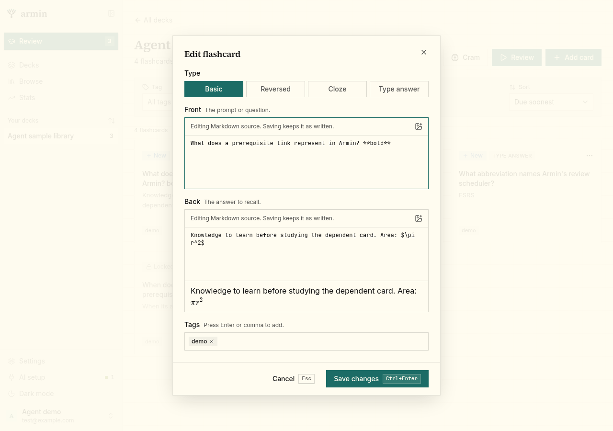
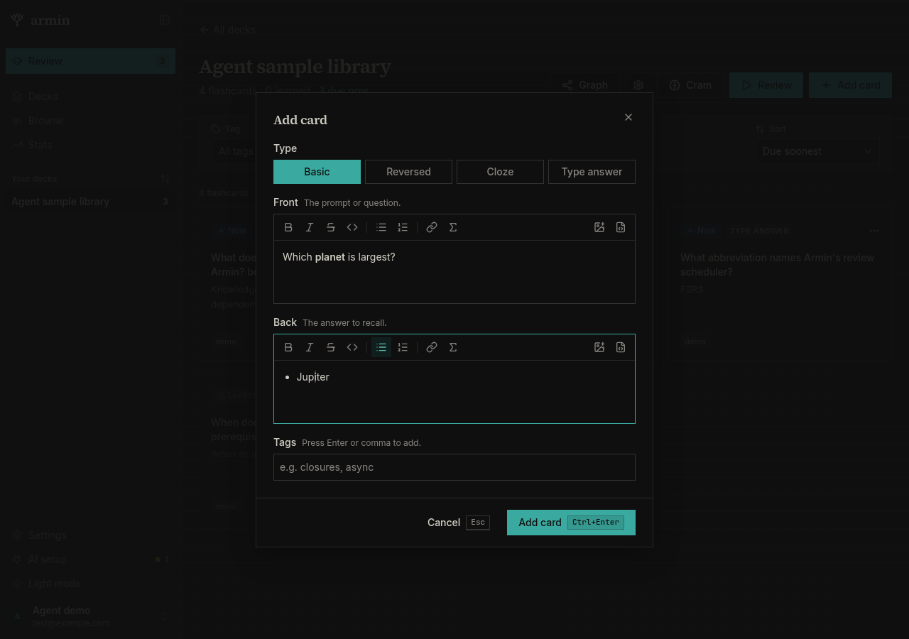
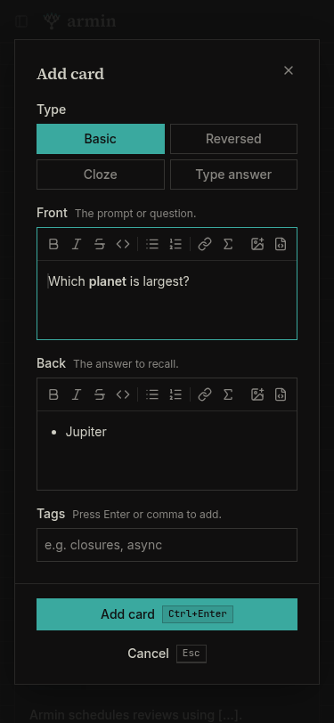
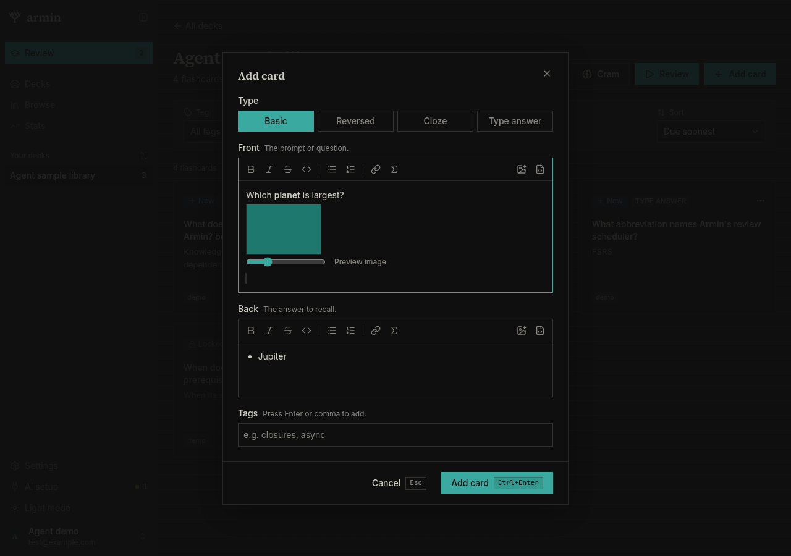
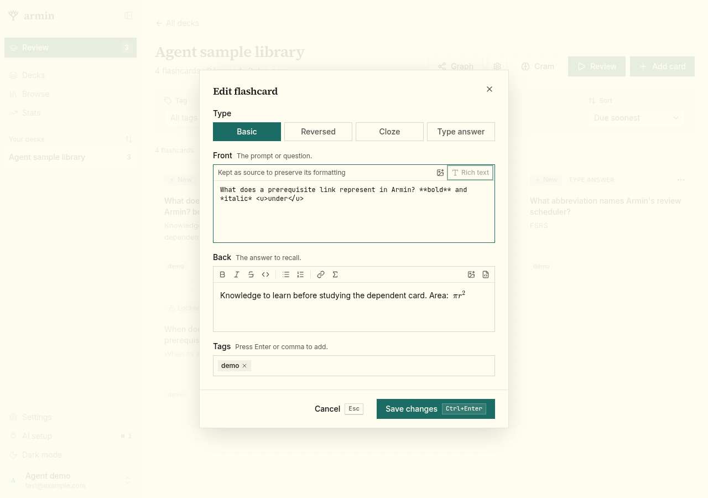

# Card editor: fixed toolbar in place of Crepe's popup

Date: 2026-10-28. Branch: `claude/rich-text-editor-ux-906110`.
Local app: `http://armin-923d5b2ff1.localhost:35852`, signed in with the
worktree's sample account. Checks used agent-browser Chromium on Linux at
1280×900, plus an emulated 375×812 viewport (not a physical phone).

## Change

Crepe's selection popup (`Crepe.Feature.Toolbar`) is off. Each card field now
has a fixed toolbar above the text, built from Armin tokens and the Base UI
tooltip: Bold, Italic, Strikethrough, Code | Bulleted list, Numbered list |
Link, Equation, then Add image and Edit source on the right. Buttons show their
active state for the focused field and list their keyboard shortcut in the
tooltip. The old footer row ("Edit source", "Add image") is gone; in source mode
the toolbar shows the source-mode note and Add image.

Crepe's remaining popovers (link, equation) and the image controls were
restyled to match Armin's popovers: border, overlay shadow, muted icon buttons,
accent focus. Fields no longer scroll internally (the scroll box clipped the
popovers); the toolbar sticks to the top of a long field while the dialog
scrolls.

## Walkthrough

1. Opened the sample card "What does a prerequisite link represent in Armin?".
   Selected text and pressed Ctrl+B: text bolded, Bold showed as active. Clicked
   Italic on a selection: italic applied, Italic active. Hovering Strikethrough
   showed "Strikethrough Ctrl+Alt+X".
   
2. Back field, Bulleted list: paragraph became a bullet. Numbered list on the
   same item converted it to a numbered list (Numbered active, Bulleted not).
   Numbered list again removed the list.
3. Selected "dependent", clicked Link: Crepe's "Paste link…" popover opened in
   the restyled frame.
   
4. Equation with no selection: inserts an equation and opens its popover with a
   placeholder `x` selected. Typed `\pi r^2`, pressed Enter: rendered πr².
   Clicking the equation reopens the popover.
   
5. With the equation popover open, Escape closed only the popover; the dialog
   stayed open. A second Escape showed "Discard changes?".
6. Saved with Ctrl+Enter, reopened, clicked Edit source on both fields. Source
   was `… Armin? **bold**` and `… Area: $\pi r^2$`. The sample card keeps these
   test edits in this worktree's local deployment.
   
7. Dark mode, Add card: typed a front with a bold word and a bulleted back.
   Bullets are indented inside the field (Crepe's reset had removed list
   padding).
   
8. 375 px emulated width: the toolbar fits on one row; page width stayed 375.
   
9. Uploaded a PNG through the Front field's file input: image inserted with the
   width slider in the accent color and a muted "Preview image" button. Draft
   discarded.
   

## Follow-up: compact toolbar and returning from source

The toolbar was reduced from 37 px to 29 px tall (24 px buttons, 14 px icons).
In source mode the toolbar now has a **Rich text** button.

10. Opened the sample card, clicked Edit source on Front, appended
    ` and *italic*`, clicked Rich text. The field returned to the rich editor
    showing **bold** and _italic_, with no textarea left.
11. Edit source again, appended `<u>under</u>`. Rich text dimmed
    (`aria-disabled`), clicking it kept the source, and the toolbar label read
    "Kept as source to preserve its formatting". This is the same rule that
    opens such cards in source mode, so switching never drops HTML or legacy
    equations. Draft discarded.
    
12. At 375 px the blocked label takes its own row above the buttons.

## Validation

`pnpm check`, `pnpm --filter @armin/web build`, and
`pnpm --filter @armin/mobile check:bundle` passed.

## Known limits

- Crepe's equation popover only saves on Enter or its check button. Escape or
  clicking elsewhere leaves the previous value (the `x` placeholder for a new
  equation).
- Underline is not offered: Markdown has no underline.
- Not checked: screen reader output, touch input on a real phone.
