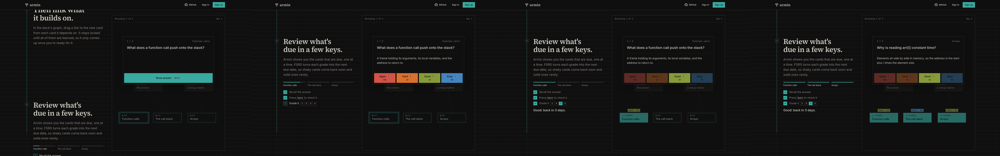
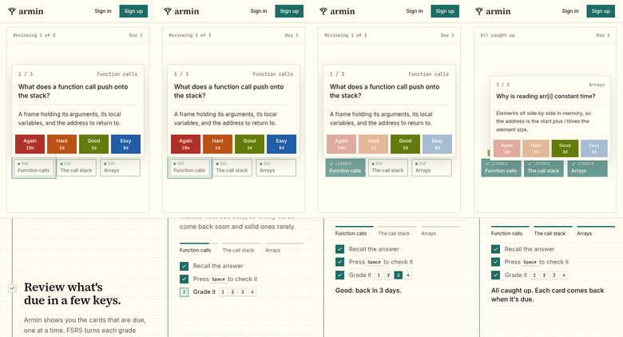

# Landing page scroll story

Running-app walkthrough on the worktree's local deployment
(`http://armin-8e0113bddc.localhost:35548/`, signed out), driven with
agent-browser in headless Chromium on Linux. Viewports are emulated: 1440×900
for desktop, 390×844 for a narrow screen. No real phone or Safari was used.

## What changed

The landing page is now one story told around one pinned example deck,
"Algorithms". The captions scroll past it, and scroll position drives the deck
through six beats:

1. **Hero:** five cards. The foundations are due, Recursion and Lookup tables
   are locked, and the space above them is empty.
2. **Write a card:** the camera moves in on that empty space and the card
   editor opens there; the front and back type out, Save card is pressed, and
   the header count goes from 5 to 6 cards.
3. **Then link what it builds on:** the editor folds into a new, unlinked
   Memoization card marked "new". A cursor drags a solid link from Recursion up
   to it, and the card locks; it then drags a second link from Lookup tables.
   Each link settles into the graph's dashed style, and the header ends on
   "Memoization locked: needs 2".
4. **Review:** the page's longest scroll, about three and a half screens on
   desktop, built as a stepper rather than a scrub. Each card has three resting
   points (question up; answer shown; grade landed), plus a final "All caught
   up". Scroll chooses the resting point, and the page then plays to it at a
   steady pace (about 0.9 s per step), so the Space press, the answer reveal,
   the grade press, and the grade landing on the graph each run in full, and
   nothing changes while you hold still. The caption holds a progress bar per
   card, the three steps for the card in review (Recall the answer; Press
   Space to check it; Grade it 1–4), whose keys light up as the stage presses
   them, and a result line ("Good: back in 3 days.") that eases in. On narrow
   screens only the bars, steps, and result hold below the stage.
5. **Unlock:** days pass in the header (Day 1 to Day 9) while accent edges
   ink upwards, and each layer unlocks once its foundations are learned.
6. **Whole subject:** the camera pulls back until the deck is one branch of a
   51-card library, with Dynamic programming just above Memoization, and
   learning climbs through it.

The previous hero animation (`unlock-graph.tsx`) and the separate interactive
review demo (`review-demo.tsx`) were removed; the story replaces both.

## The review beat

The four resting points of the first card and the wrap-up (dark, desktop):
question up with "Recall the answer" current; answer shown with "Grade it"
current; Good pressed, its key lit, and the result line; then all three cards
graded.

The same resting points at 390×844 (light).

- Sampled in the page while moving from the question to the answer: Space shows
  as pressed for about 150 ms, the answer is fully revealed by about 700 ms, and
  the step marks advance once, in order.
- A scripted 12-second scroll through the whole story recorded 721 frames, none
  over 20 ms, on this development machine. Not measured on a mid-range phone.
- No console errors or warnings during the walkthrough.

## Narrow screens

The hero comes first; the deck then pins under the header and the captions
scroll beneath it.

## Reduced motion

With `prefers-reduced-motion: reduce` emulated, the deck shows one settled
frame per beat and crossfades between them; nothing scrubs, zooms, or types.
The review beat shows each of its resting points directly (question, answer,
graded) with the caption steps matching, and nothing plays between them.

## Checks

- `pnpm check`, `pnpm --filter @armin/web build`, and
  `pnpm --filter @armin/mobile check:bundle` pass.

Not verified: Safari and Firefox, a real phone (scroll feel, stage height with
browser chrome, frame rate), and screen readers beyond the stage being hidden
from the accessibility tree while captions carry the text.
