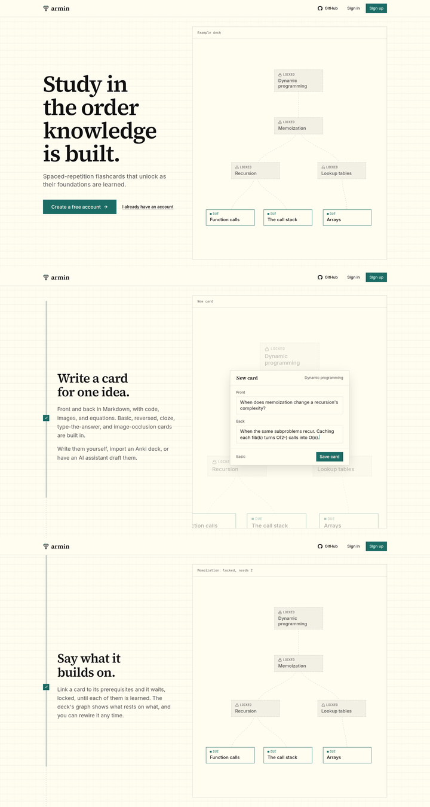
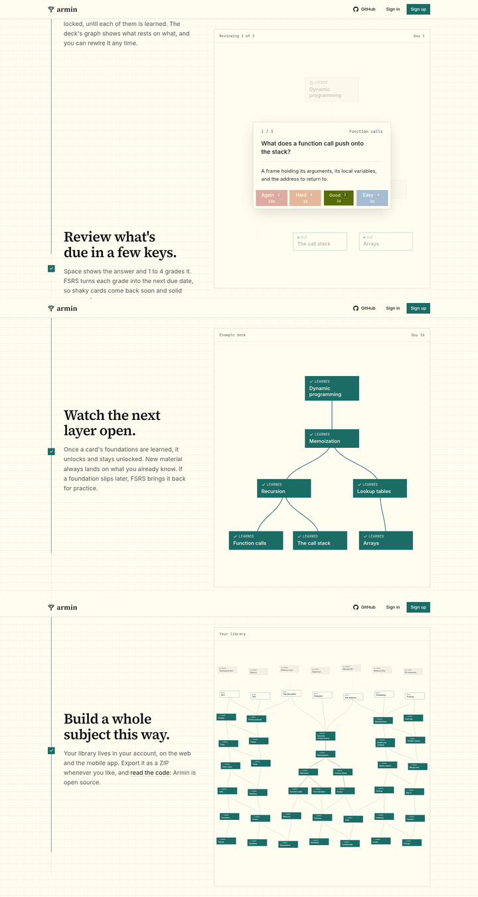
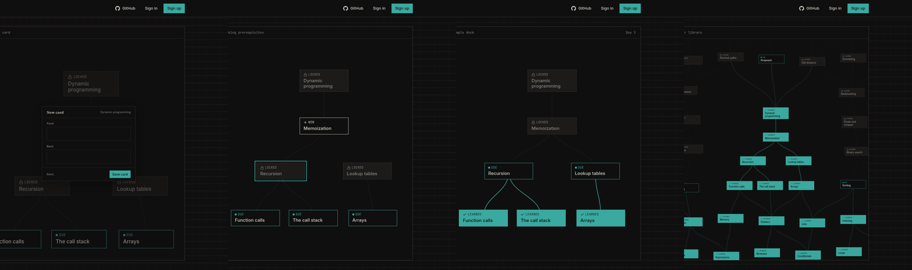
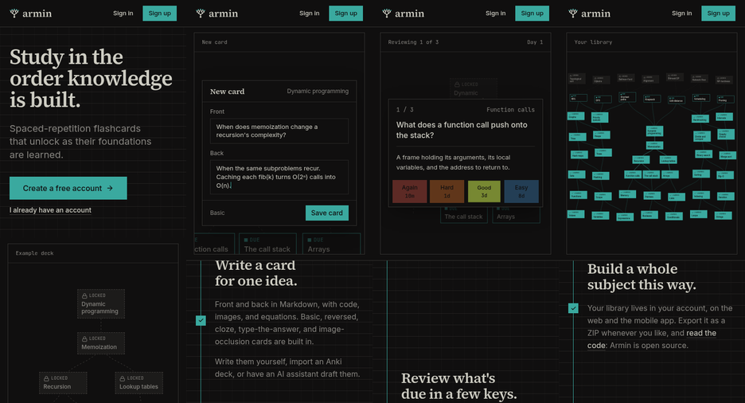
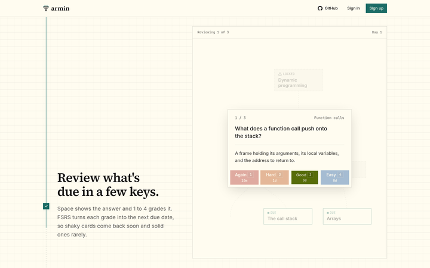

# Landing page scroll story

Running-app walkthrough on the worktree's local deployment
(`http://armin-8e0113bddc.localhost:35548/`, signed out), driven with
agent-browser in headless Chromium on Linux. Viewports are emulated: 1440×900
for desktop, 390×844 for a narrow screen. No real phone or Safari was used.

## What changed

The landing page is now one story told around one pinned example deck. The
captions scroll past it, and scroll position drives the deck through six beats:

1. **Hero:** the deck, with its foundations due and everything above them locked.
2. **Write a card:** the camera moves in and Memoization opens into the card
   editor; the front and back type out, and the card is saved.
3. **Say what it builds on:** the editor folds back into its card, and the
   edges from Recursion and Lookup tables draw in. The card locks.
4. **Review:** a card lifts out of Function calls, Space shows the answer, and 3
   grades it Good. The three foundations are learned, each with its grade chip.
5. **Unlock:** accent edges ink upwards while the day counter moves from Day 1
   to Day 16, and each layer unlocks once its foundations are learned.
6. **Whole subject:** the camera pulls back until the deck is one branch of a
   larger library, and learning climbs through it.

The previous hero animation (`unlock-graph.tsx`) and the separate interactive
review demo (`review-demo.tsx`) were removed; the story replaces both.

## Motion between beats

Captured mid-scroll (dark): the editor opening out of its card, Memoization
marked new while the Recursion edge draws, the cascade's edges inking upwards,
and the pull-back.

- A scripted 6-second scroll through the whole story recorded 362 frames, none
  over 20 ms, on this development machine. Not measured on a mid-range phone.
- No console errors or warnings during the walkthrough.

## Narrow screens

The hero comes first; the deck then pins under the header and the captions
scroll beneath it.

## Reduced motion

With `prefers-reduced-motion: reduce` emulated, the deck shows one settled
frame per beat and crossfades between them; nothing scrubs, zooms, or types.
The review beat keeps its card open with the answer shown and Good chosen.

## Checks

- `pnpm check`, `pnpm --filter @armin/web build`, and
  `pnpm --filter @armin/mobile check:bundle` pass.

Not verified: Safari and Firefox, a real phone (scroll feel, stage height with
browser chrome, frame rate), and screen readers beyond the stage being hidden
from the accessibility tree while captions carry the text.
