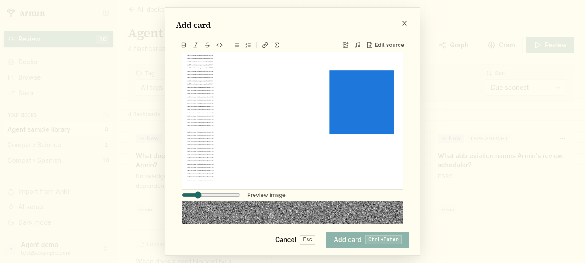
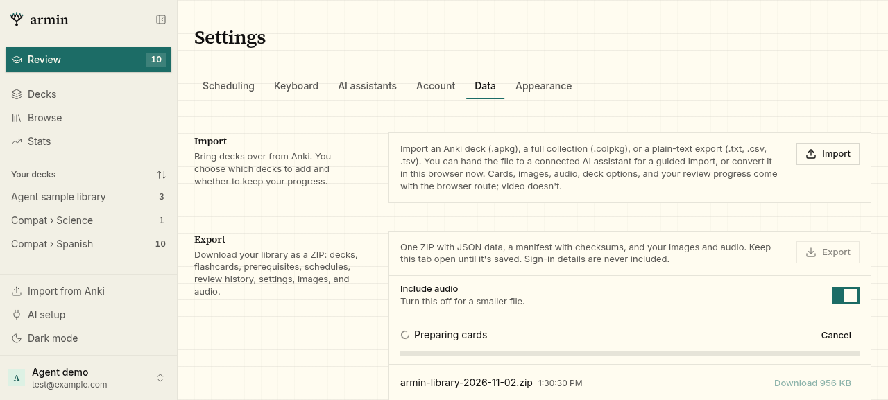
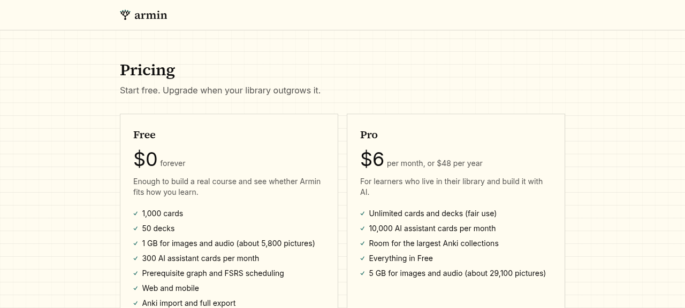
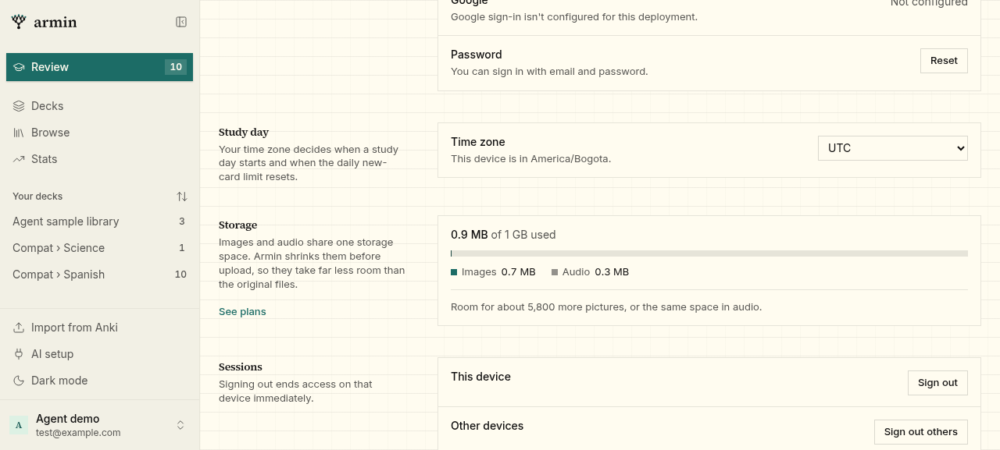
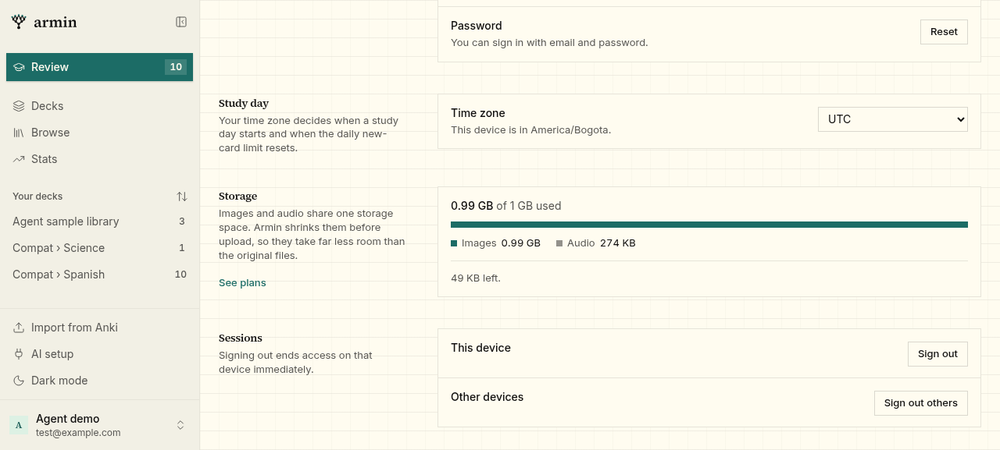
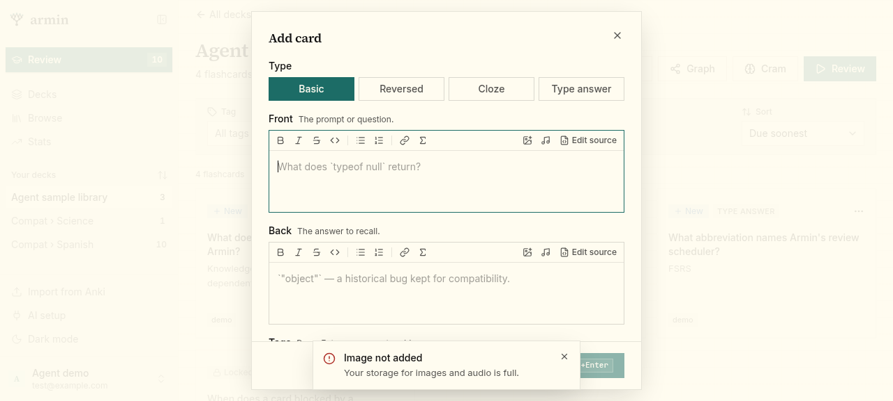
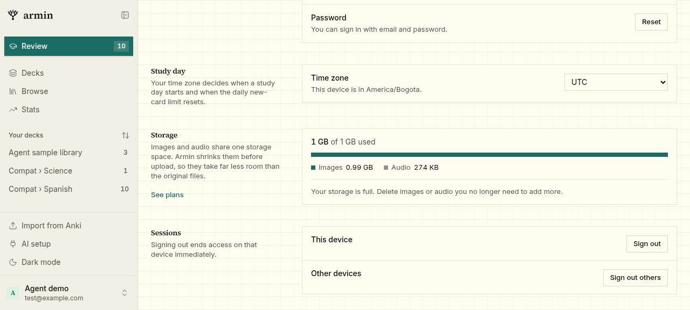
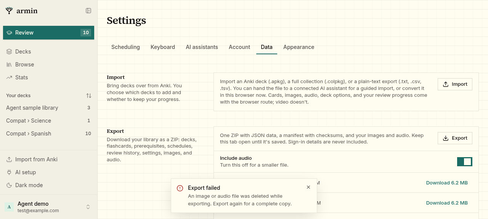

# Media shrinking, browser export, and higher image limits

Running-app walkthrough on the worktree's local deployment
(`http://armin-cf02f707a7.localhost:36844`, sample account), driven with
agent-browser in headless Chromium on Linux. Test files were generated with
Pillow; sizes are for those files, not for real user libraries.

## 1. Images shrink on the device

Uploaded through the card editor's **Add image** button. Sizes are the bytes
the browser sent and the server stored (`media` table).

| File | Original | Stored | Notes |
| --- | --- | --- | --- |
| `photo.jpg` 4000×3000, EXIF orientation 6, GPS, camera make | 11,154,635 B (over the 10 MiB server limit) | 516,834 B WebP, 1200×1600 | Accepted; turned upright; no EXIF or GPS left in the file |
| `diagram.png` 2400×1500 text and flat colours | 107,806 B | 60,958 B WebP, 1600×1000 | Lossless (`VP8L` chunk) |
| `small.jpg` 600×400, no EXIF | 108,675 B | 108,675 B JPEG | Original kept: re-encoding saved less than 10% |

- New `media` rows have width and height and no `thumbnailId`; the quota
  counts only the stored bytes.
- `/media/<file>` responds with `Cache-Control: private, max-age=31536000, immutable`.

Not verified on a real device: Safari's WebP encoding and the JPEG/PNG
fallback path, and iOS canvas limits for very large camera photos.

## 2. Audio shrinks on the device

Uploaded through the card editor's **Add audio** button in Chromium.

| File | Original | Stored | Notes |
| --- | --- | --- | --- |
| `speech.mp3` espeak-ng Spanish sentence, stereo 128 kbps, 0.5 s silence at each end, 3.66 s | 59,811 B | 10,173 B Ogg Opus, mono 48 kHz, 2.56 s | Silence trimmed to 0.1 s padding |
| `long.wav` 60 s stereo PCM | 10,584,078 B (over the 10 MiB server limit) | 238,406 B Ogg Opus, 59.99 s | Accepted |
| `low.mp3` mono 24 kbps | 15,168 B | 15,168 B MP3 | Already below the target quality; original kept |

- `ffprobe` reads the stored speech clip as Opus, mono, 48 kHz, and `ffmpeg`
  decodes it without errors (Ogg page checksums valid).
- In the browser the clip decodes, plays to the end, and fires `ended`.
- Chromium reports `Infinity` for the `<audio>` element's duration of these
  Ogg files because the media route doesn't serve byte ranges. The card audio
  player doesn't use duration.

Not verified: Opus playback on Mac Safari and iPhone (caniuse lists iOS Safari
18.4+ as supported and Mac Safari as partial), and encoding in Firefox and
Safari 26.

## 3. Export is assembled in the browser

Settings → Data → **Export**, on the same library (17 flashcards, 10 media
files including the QA uploads above).

- **Save-dialog path (Chrome/Edge).** `showSaveFilePicker` was replaced with a
  stand-in that records the chunks written to it, since headless Chromium has
  no save dialog. The progress row showed "Preparing cards", then saved.
  The 981,956-byte ZIP passes Python's `zipfile.testzip()`, contains the
  manifest, README, six data files, and all 10 media files, and every manifest
  checksum matches its file.
- **In-memory path (Firefox/Safari).** With `showSaveFilePicker` removed and
  **Include audio** off, the browser built a 699,254-byte ZIP and downloaded it
  through a link. It holds the 4 images and no audio; every checksum matches.
- The server's stored ZIP now holds only the manifest and data; its listed
  size includes the media, so **Download** shows the approximate final size.

Not verified: a real save dialog, Firefox and Safari themselves, Cancel, and a
library large enough to exceed the old 95 MiB limit.

## 4. Higher image limits

- Image limits rose to 250 MiB (Free) and 2 GiB (Pro), later replaced by the
  shared pool in section 5. Picture counts on the pricing page are the limit ÷
  180 KiB (a typical shrunk picture), rounded to the nearest hundred.
- The unused 80 MiB `MAX_LIBRARY_MEDIA_BYTES` constant is removed. The Anki
  converter kit bundles that module, so the unreleased kit 1.1.0's manifest
  checksum was regenerated.

## 5. One storage pool for images and audio

- Plan limits now have one `mediaBytes` pool: 1 GiB (Free) and 5 GiB (Pro).
  Uploads check images plus audio together against it; the two counters stay
  separate only to show the split. Quota errors now say "Your storage for
  images and audio is full."
- Settings → Account → **Storage** shows "0.9 MB of 1 GB used" for the test
  library, a bar split into Images 0.7 MB and Audio 0.3 MB, "Room for about
  5,800 more pictures", and a **See plans** link on the Free plan.
- The pricing page lists "1 GB for images and audio (about 5,800 pictures)"
  and "5 GB for images and audio (about 29,100 pictures)".

### Full pool

The local `libraryCounters` row was backed up, replaced with
`convex import --table libraryCounters --replace` to fill the pool, and then
restored. Uploads went through the card editor in Chromium.

| Pool state | Upload | Sent | Result |
| --- | --- | --- | --- |
| 50,000 B left | 1200×900 noise JPEG | 704,010 B (kept as JPEG) | 413, toast "Image not added · Your storage for images and audio is full." |
| 50,000 B left | 31.7 s speech MP3 (507,863 B) | 131,586 B Ogg Opus | 413, same message; audio counter unchanged |
| 50,000 B left | 64×64 PNG | 408 B | Stored; image counter +408 |
| Exactly 1 GiB | 8×8 PNG | 77 B | 413, same message |

- Nearly full, Storage showed "0.99 GB of 1 GB used", Images 0.99 GB, Audio
  274 KB, and "49 KB left."
- Full, it showed "1 GB of 1 GB used", a full bar, and "Your storage is full.
  Delete images or audio you no longer need to add more."
- Rejected uploads' blobs are deleted by the upload action.
- Fixed during the test: the page first read "1024 MB of 1 GB used" and would
  have shown "0 MB left" for small remainders. Sizes near 1 GB now show in GB
  rounded down to two decimals, and sizes under 1 MB show in KB.
- After restoring, the counters (691,955 B images, 280,984 B audio) equal the
  sum of the library's 11 `media` rows.

Not verified: the full-pool message during a browser Anki import or an
assistant import, and space being freed after media is deleted (unreferenced
files are collected an hour after they stop being used).

## Validation

`pnpm check`, `pnpm --filter @armin/web build`, and
`pnpm --filter @armin/mobile check:bundle` pass. The mobile app itself is
unchanged.

## Review fixes

- A full pool during a browser Anki import stopped being recognised once the
  message changed, so the runner would skip files and import partially. The
  server and the runner now share `MEDIA_STORAGE_FULL_MESSAGE`
  (`@armin/core/plans`).
- Card audio now stops when the card side that started it goes away. In
  Chromium, a review clip started from its button and followed 0.3 s later by
  leaving for Decks reported `paused: true, ended: false` at 0.67 s of a
  0.80 s clip.
- Animated images are no longer flattened to their first frame. In Chromium,
  a 3-frame animated WebP (1,015,218 B) and APNG (3,956,362 B) uploaded
  byte-for-byte unchanged, while a still 900×600 PNG still shrank from
  1,251,954 B to a 499,704 B WebP. AVIF sequences are detected by their
  `avis` brand but weren't tested.
- An Anki preset with explicitly empty learning or relearning steps now
  imports as no steps (`""`) instead of falling back to the library's `10m`
  default; a preset that doesn't say still keeps the default. The unreleased
  kit 1.1.0 checksum was regenerated.
- Exports now use a streaming writer (`apps/web/src/lib/zip-writer.ts`) that
  switches to ZIP64 records past 4 GiB, and drop each media file from memory
  once written. In Node, the writer produced a 4,718,640,666-byte archive of
  450 × 10 MiB files plus a deflated JSON file stored after the 4 GiB mark;
  Python's `zipfile.testzip()` and `unzip -t` both report no errors. A small
  archive stays a plain ZIP (version 2.0).
- A browser export with the new writer: 22 entries, manifest first, 14 media
  files, every checksum matches.
- A media file that returns 404 mid-export now fails the export with "An image
  or audio file was deleted while exporting. Export again for a complete copy."
  Export errors written for users now show in full instead of "Something went
  wrong."

- Imported desired retention is rounded before the 70–99% range check, so
  float32 values such as 0.699999988 (70%) and 0.990000010 (99%) keep the
  preset's retention instead of falling back to the library's. Kit 1.1.0
  (unreleased) checksum refreshed.
- Loaded card audio is now an LRU cache of 32 clips; older blob URLs are
  revoked, except the one playing. Review audio still autoplays and plays to
  the end in Chromium.
