# Convex and TanStack Query patterns

Running-app walkthrough after replacing hand-written client state with Convex
and TanStack Query features on `t3/bb2378dd`:

- Deck create, rename, delete, and pin, plus keybinding saves, use Convex
  optimistic updates (`apps/web/src/lib/optimistic.ts`). They replace the
  hand-written `pending-deck-edits.ts` and `pending-pins.ts` stores and the
  keybinding provider's `setQueryData` write.
- Review answers and graph writes run in TanStack Query mutation scopes
  (one at a time, in order; answers retry with backoff). They replace the
  hand-written save loop and promise chain.
- `useConnection` reads Convex's `useConvexConnectionState` and TanStack's
  `onlineManager` instead of a custom store.
- `review-session.tsx` and `anki-import-page.tsx` are split into
  `components/review-session/` and `components/anki-import/`.

Run on the worktree's local deployment (`http://armin-617674d9bf.localhost:29264`,
sample account), driven with agent-browser in headless Chromium on Linux.
This is a desktop browser on the development machine, not a phone.

Automated checks: `pnpm check`, `pnpm --filter @armin/web build`, and
`pnpm --filter @armin/mobile check:bundle` pass.

Before changing anything, I confirmed that the TanStack adapter
(`@convex-dev/react-query` 0.1.0) subscribes through
`convexClient.watchQuery(...).localQueryResult()`. That result includes Convex
optimistic updates, so every page and the sidebar see them.

## 1. Deck list edits (Convex optimistic updates)

- **Create:** clicked **Create deck** and sampled the DOM on every animation
  frame. In the first frame, the grid and the sidebar showed **QA optimistic deck** as
  an inert, faded placeholder. It became the real, openable deck when the server
  result arrived. No frame showed both the placeholder and the real deck.
- **Pin:** **Pin to sidebar** moved the deck under **Pinned** in the sidebar,
  and the tile menu then offered **Unpin from sidebar**.
- **Rename:** two frames after **Save**, every occurrence read **QA renamed
  deck** and the old name was gone. The name stayed after the server
  confirmed it.
- **Delete:** two frames after confirming, the deck was gone from the grid,
  and it stayed gone from the whole page afterwards.

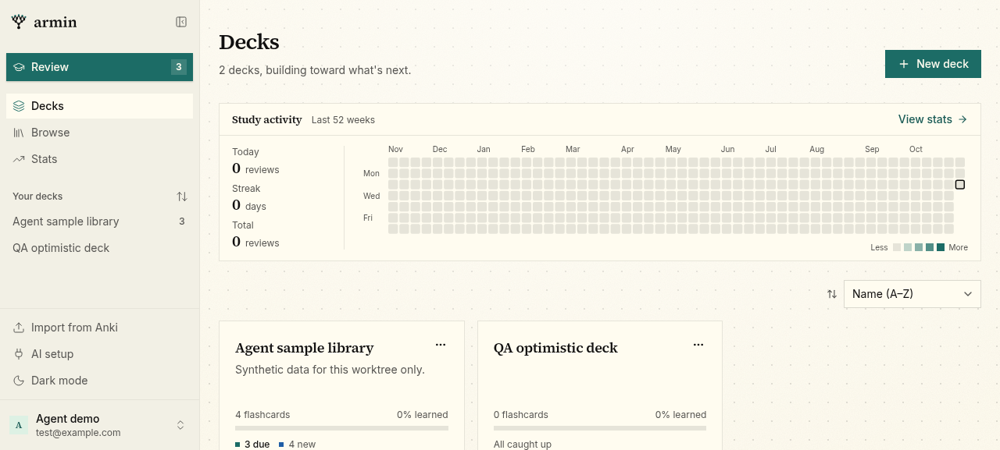
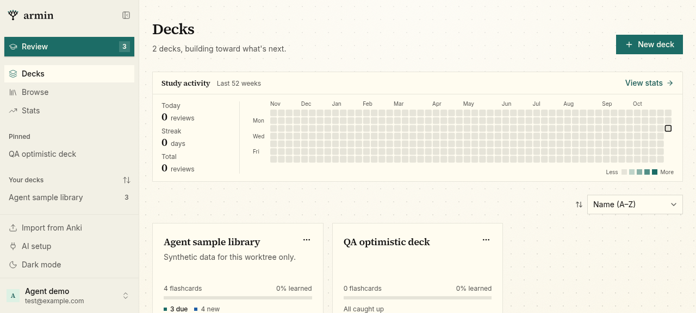
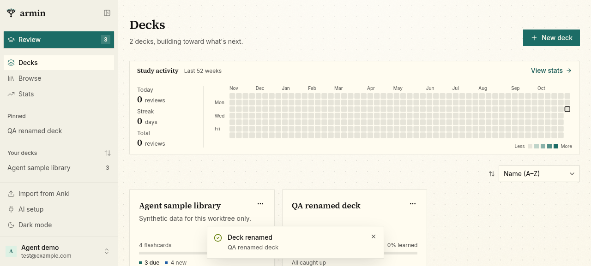

## 2. Review answers (scoped mutation)

- On **Review** (3 due), revealing the typed-answer card loaded the rating
  intervals (Again 10m, Hard 15m, Good 2d, Easy 6d).
- I rated three cards back to back from the keyboard (`3`, `Space`, `3`,
  `Space`, `3`) without waiting between keys. All three saved. The sidebar due count went from 3
  to 1, and the prerequisite-locked card unlocked and joined the session
  (4 / 4). No "Retrying" or offline notice appeared.
- **Undo** waited for the saves, then brought back card 3 / 4. The due count
  went back to 2.

The retry path (a save that throws) was not triggered in this walkthrough.

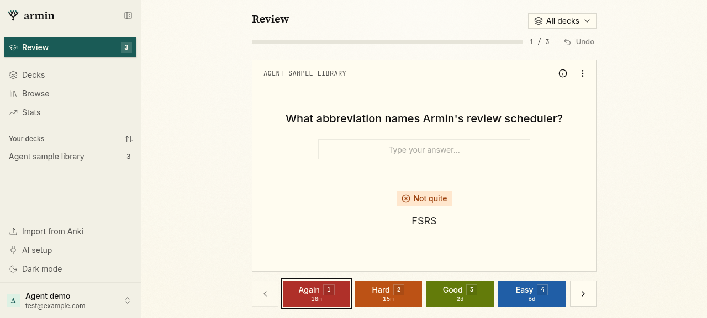
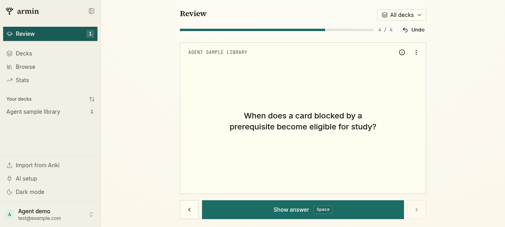
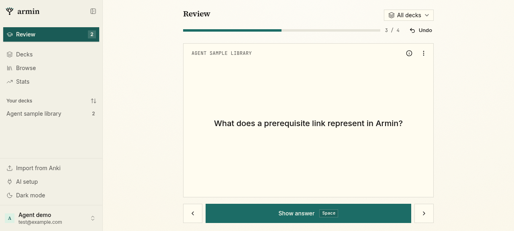

## 3. Prerequisite graph (scoped mutation)

- The graph for **Agent sample library** rendered its nodes and edge. After
  **Fit view**, I dragged one card to the right. Its position
  (`translate(313px, 548px)`) was saved and stayed the same after a full reload.
- A first drag that started on empty canvas panned the view instead. The panned view is
  saved per deck, as before. **Fit view** brings the cards back.

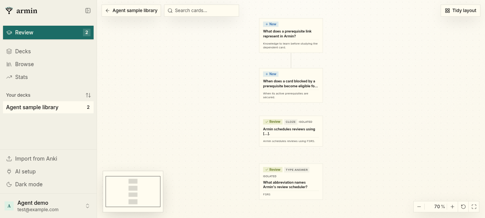
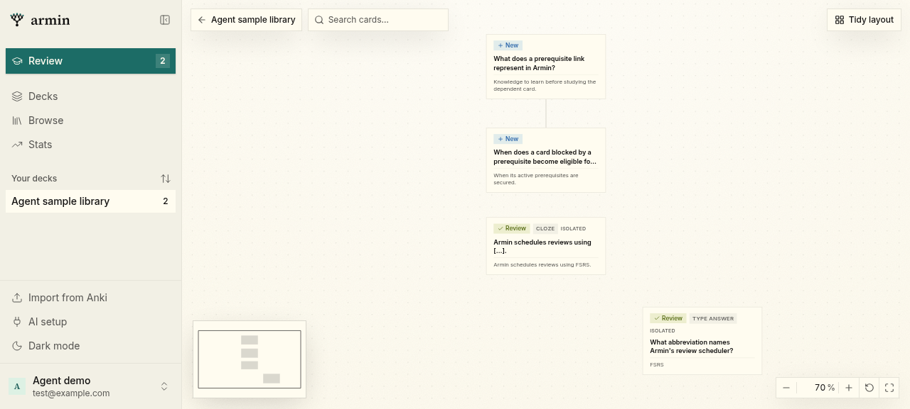

## 4. Anki import page (split into step files)

- `/import` rendered the assistant route and the browser drop zone.
- Uploading a two-line tab-separated text file showed the preview step
  (**qa-cards**, 2 cards). **Import** ran to the done step (2 cards,
  1 deck, prerequisite prompt), and **qa-cards** appeared in the sidebar.

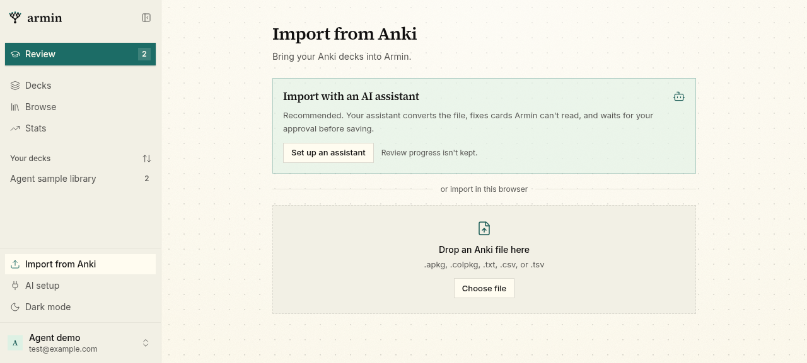
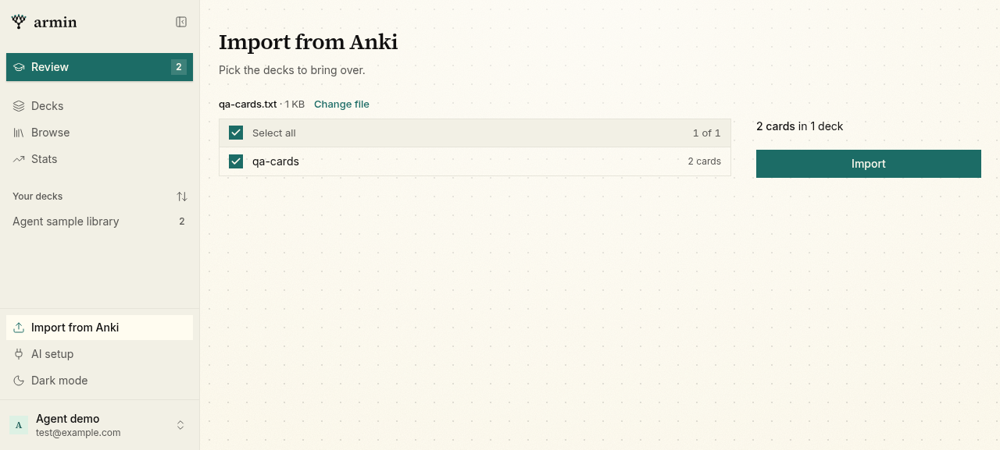
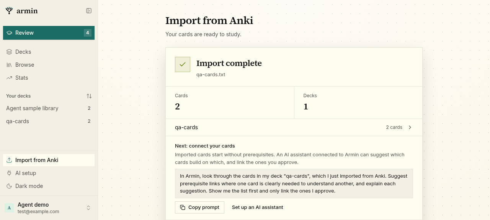

## Not exercised

- Rebinding a key in Settings → Keyboard (the keybinding optimistic update). It
  is covered only by type checking.
- Adding or removing a prerequisite link on the canvas. These use the same
  scoped `writeGraph` path as the layout save above.
- Behavior on a real mobile device.
