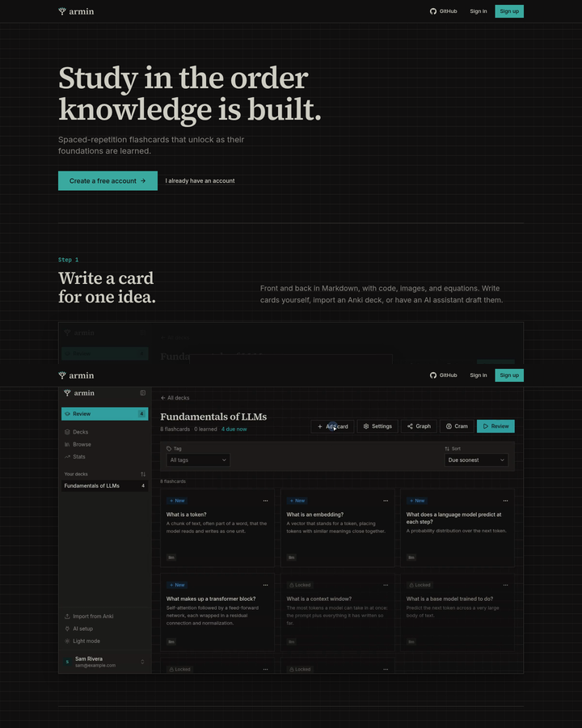
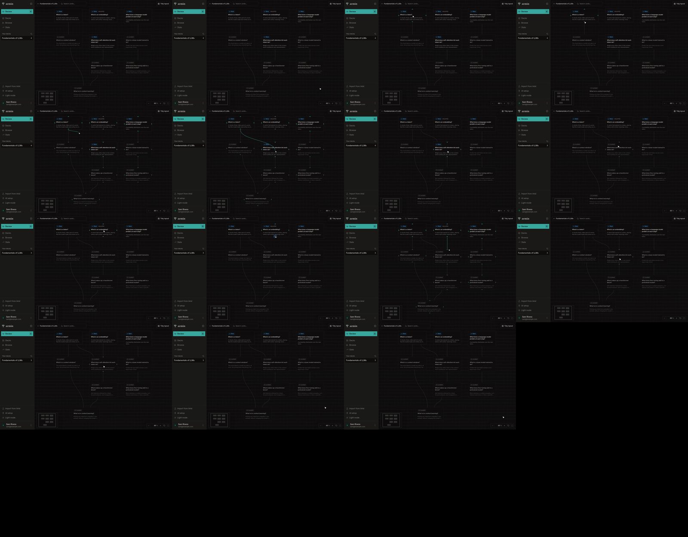
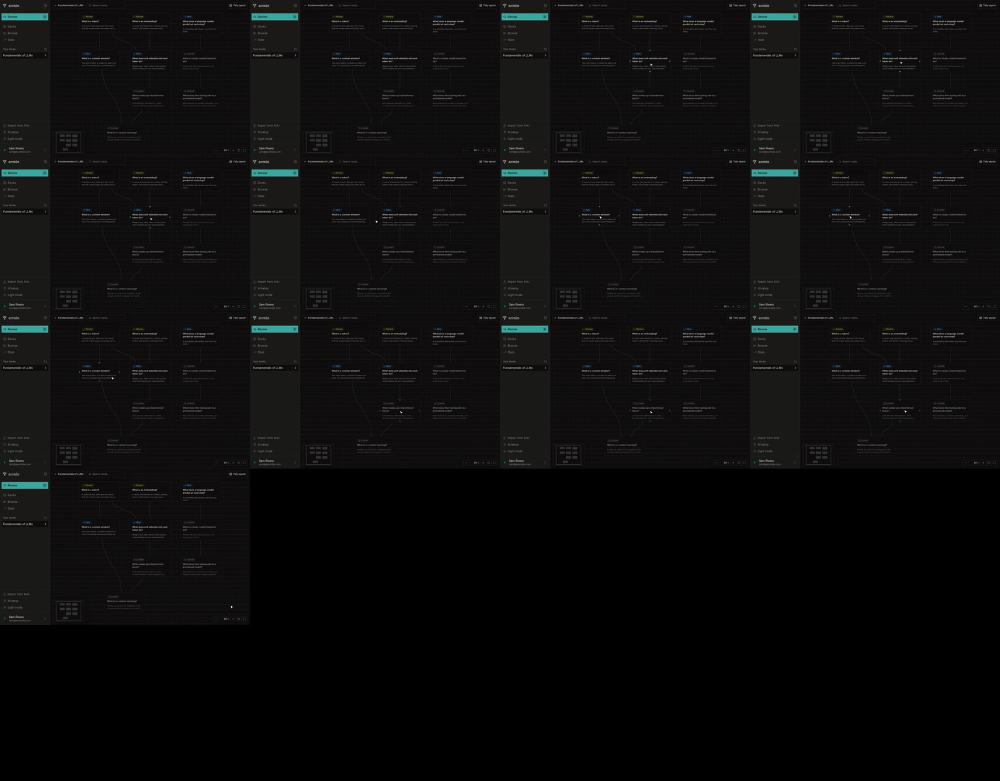

# Landing page clips

Running-app walkthrough on the worktree's local deployment
(`http://armin-8e0113bddc.localhost:35548/`, signed out), driven with
agent-browser in headless Chromium on Linux. Viewports are emulated: 1440×900
for desktop, 390×844 for a narrow screen. No real phone or Safari was used.

## What changed

The scroll-driven recreation of the app is gone. The landing page is now a
hero followed by four steps, each with a heading, one paragraph, and a short
silent clip of the real app in dark mode, working through one example deck,
"Fundamentals of LLMs":

1. **Write a card** (20 s): Add card on the deck page; the front and back of
   "What does self-attention let each token do?" are typed and saved.
2. **Link what it builds on** (15 s): in the deck's graph, links are dragged
   from Tokens and from Embeddings to Self-attention, which turns Locked.
3. **Review what's due** (14 s): Tokens and Embeddings are shown and graded
   Easy. The session's count grows from 3 to 4 as Context window unlocks.
4. **Watch the next layer open** (13 s): the graph after review. Tokens and
   Embeddings show Review, Self-attention and Context window show New, and the
   pointer hovers each to light its links.

## Playback

- Each clip is an H.264 MP4 (1920×1200, no audio, 220–410 KB) with a JPEG
  poster of its last frame, in `apps/web/public/landing/`.
- Clips load nothing until they scroll into view (`preload="none"`). In view
  they restart from the beginning and loop; out of view they pause. Checked at
  1440×900: with step 1 in view only its clip had loaded and was playing.
- No console errors during the walkthrough.

## Narrow screens

At 390×844 the clips scale to the column width. The screens are recognizable
but their text is too small to read, so each step's paragraph carries the
meaning there.

## Reduced motion

With `prefers-reduced-motion: reduce` emulated, no clip autoplays: each shows
its poster with video controls, so it plays only on request.

## Re-recording

`pnpm --filter @armin/web landing:clips` re-records all four clips with
`pnpm dev` running. It resets the deck in a dedicated demo account
(`sam@example.com`, created on this checkout's local deployment only), signs
in through the app, drives each step with agent-browser's recorder, and
encodes the clips and posters with ffmpeg. A full run takes under two
minutes. Rerun it after UI changes that the clips show.
