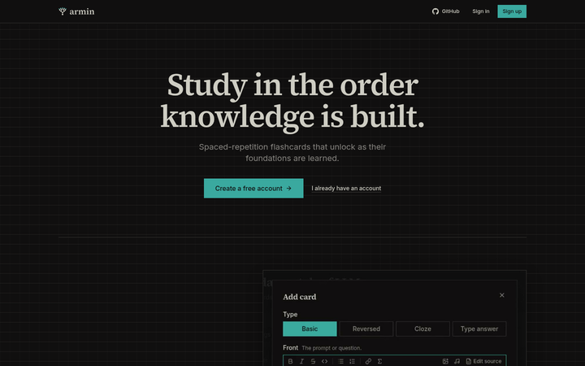
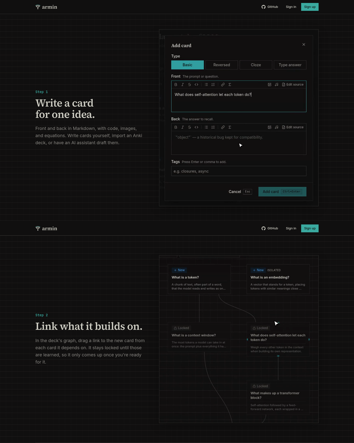
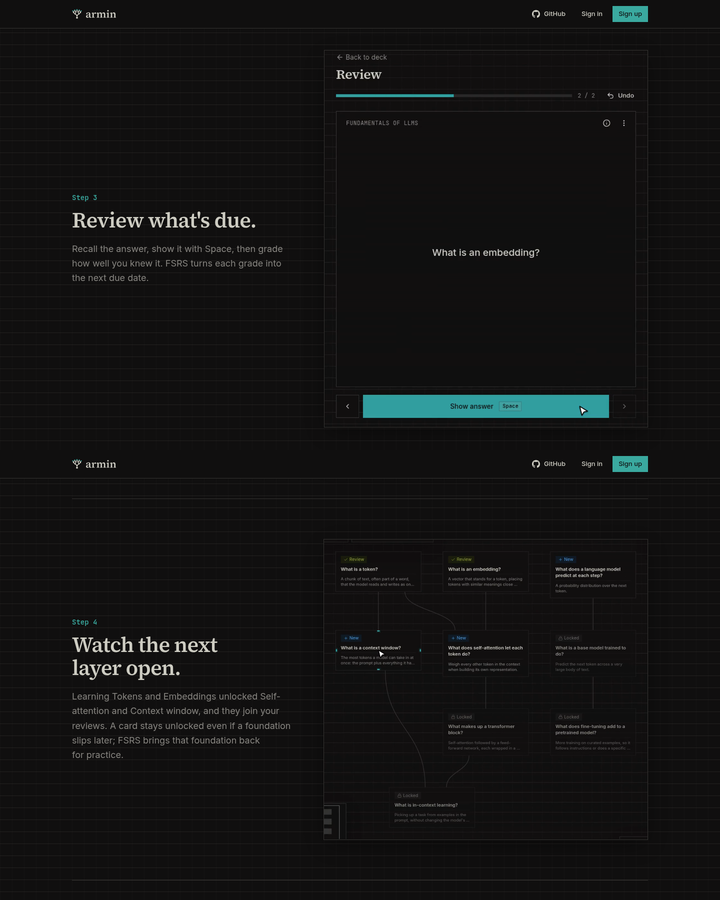
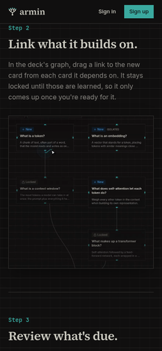
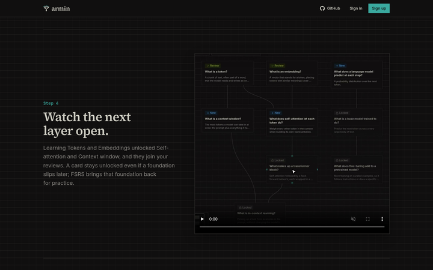

# Landing page clips

Running-app walkthrough on the worktree's local deployment
(`http://armin-8e0113bddc.localhost:35548/`, signed out), driven with
agent-browser in headless Chromium on Linux. Viewports are emulated: 1440×900
and 1280×720 for desktop, 390×844 for a narrow screen. No real phone or Safari
was used.

## What changed

The scroll-driven recreation of the app is gone. The landing page is a
centered hero followed by four steps. On wide screens each step's heading and
paragraph sit beside a short, silent clip of the real app in dark mode; on
narrow screens the clip follows the text. Every clip works through one example
deck, "Fundamentals of LLMs", and is cropped to the part of the screen its step
is about:

1. **Write a card** (9 s), cropped to the Add card button and dialog: the
   front and back of "What does self-attention let each token do?" are typed
   and saved.
2. **Link what it builds on** (9 s), cropped to the four cards involved: links
   are dragged from Tokens and from Embeddings to Self-attention, which turns
   Locked.
3. **Review what's due** (9 s), cropped to the review column: Tokens and
   Embeddings are shown and graded Easy. The session grows from 2 to 3 cards as
   Context window unlocks.
4. **Watch the next layer open** (7 s), cropped to the graph's cards: Tokens and
   Embeddings show Review, Self-attention and Context window show New, and the
   pointer hovers each to light its links.

## Playback

- Each clip is an H.264 MP4 (no audio, 130–210 KB) played 1.2× faster than it
  was recorded, with a JPEG poster of its last frame, in
  `apps/web/public/landing/`. Their sizes are in
  `apps/web/src/components/landing/clips.json`.
- A clip is never taller than the screen, so at 1440×900 and 1280×720 each
  step's text and its whole clip are in view together.
- Clips load nothing until they scroll into view (`preload="none"`). In view
  they restart from the beginning and loop; out of view they pause.
- No console errors during the walkthrough.

## Narrow screens

At 390×844 the clip follows its text at the column width. The crops keep the
interface larger than a full-window recording would, but small text is still
hard to read.

## Reduced motion

With `prefers-reduced-motion: reduce` emulated, no clip autoplays: each shows
its poster with video controls, so it plays only on request.

## Re-recording

`pnpm --filter @armin/web landing:clips` re-records all four clips with
`pnpm dev` running. It resets the deck in a dedicated demo account (Armin
Arlert, `armin.arlert@example.com`, created on this checkout's local deployment
only), signs in through the app, drives each step with agent-browser's
recorder, and crops, speeds up, and encodes the clips with ffmpeg. Before the
review clip it buries "What does a language model predict at each step?" for
the day, so the review queue holds only Tokens and Embeddings. A full run takes
about two minutes. Rerun it after UI changes that the clips show.
