# Code simplification pass

Running-app walkthrough after the behavior-preserving simplification commits on
`t3/cf28e732` (`339db53` through `cca50e3`). Run on the worktree's local
deployment (`http://armin-d5c3cb398b.localhost:37164`, sample account), driven
with agent-browser in headless Chromium on Linux. The Anki fixture is synthetic
(`docs/research/anki-import-bench/make-fixture.py`, 300 notes, 20 images, 300
review logs); it is not a real deck.

Automated checks: `pnpm check`, `pnpm --filter @armin/web build`,
`pnpm --filter @armin/mobile check:bundle`, and `pnpm anki:kit:verify` all pass.

## 1. Card editing and uploads

- Edited a card on the deck page and added a 64×64 PNG through **Add image**.
  The upload went through the shared `readUploadBody`/`mediaFileName` path;
  the stored name is the SHA-256 of the bytes `/media/<file>` serves
  (`1228d8a1…`, checked in the browser). Saving showed **Flashcard updated**
  (shared `useUpdateFlashcard`).
- The deck page's **All decks** link renders from the shared component.

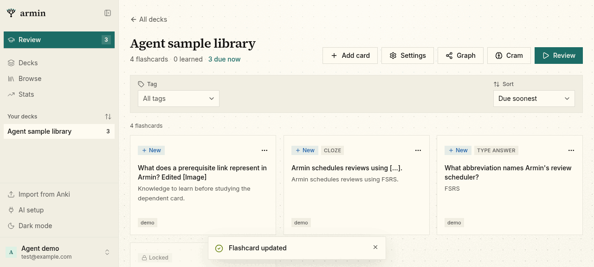

## 2. Delete dialogs

- Tile delete dialog: same copy, **Archive instead**, and consequence counts
  ("0 dependents…", "No review history… across 1 review unit"). Cancel left the
  card in place.
- Graph delete dialog now renders the shared `DeleteConsequencesList`; its text
  is unchanged.
- On the graph, double-clicking the pane created **QA graph card** in the deck
  (single `deckId` parameter), and deleting it from the node menu showed
  **Flashcard deleted** and removed only that node.

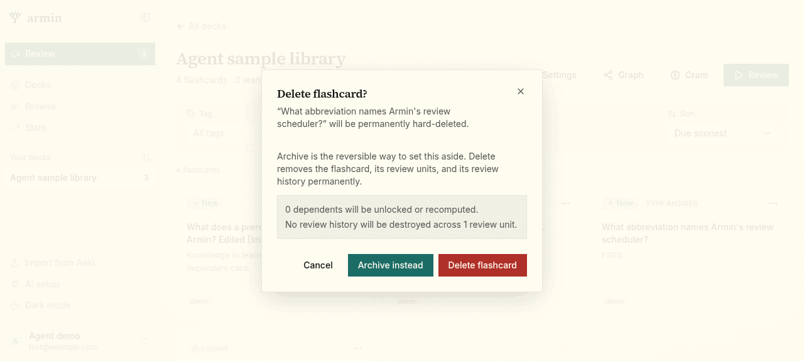
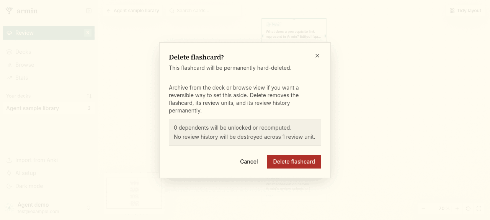
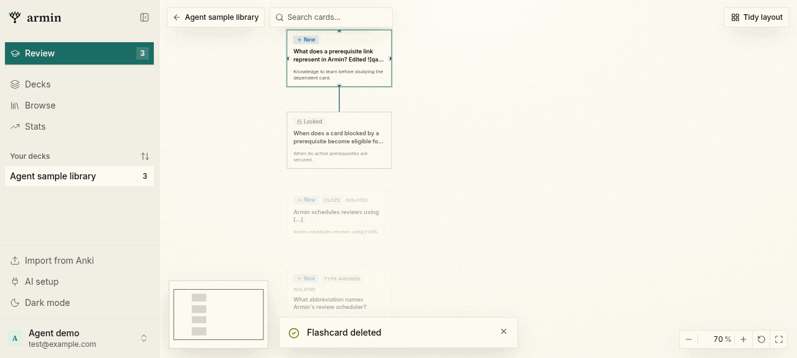

The graph renders only visible nodes, so a node outside the viewport is absent
from the DOM until **Fit view**; that is existing behavior.

## 3. Cram

- The cram dialog's count reads "3 review units match" (`matchCountLabel`).
- **Start** opened a 3-card session ordered by the server's seeded shuffle (now
  core's `shuffle` with the same generator). Rating Good advanced to 2 / 3 and
  enabled Undo. **Back to deck** renders from the shared component.

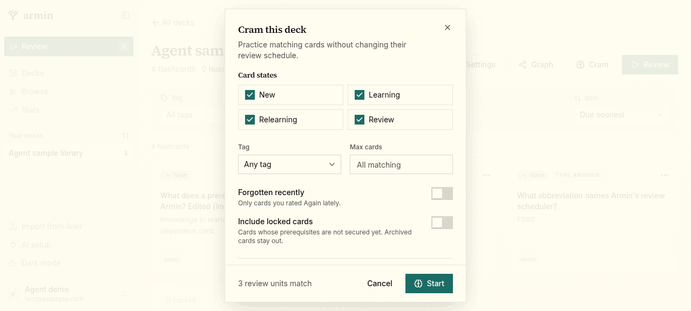

## 4. Deck not found

A temporary deck's graph, review, and deck pages were open in other tabs when
the deck was deleted. Each switched to its shared not-found state: the graph
and deck pages show **All decks** plus the empty state; review shows the session
card. An unknown slug typed into the URL still gets the router's generic
**Page not found** from `deck.$deckId.tsx`, unchanged by this work.

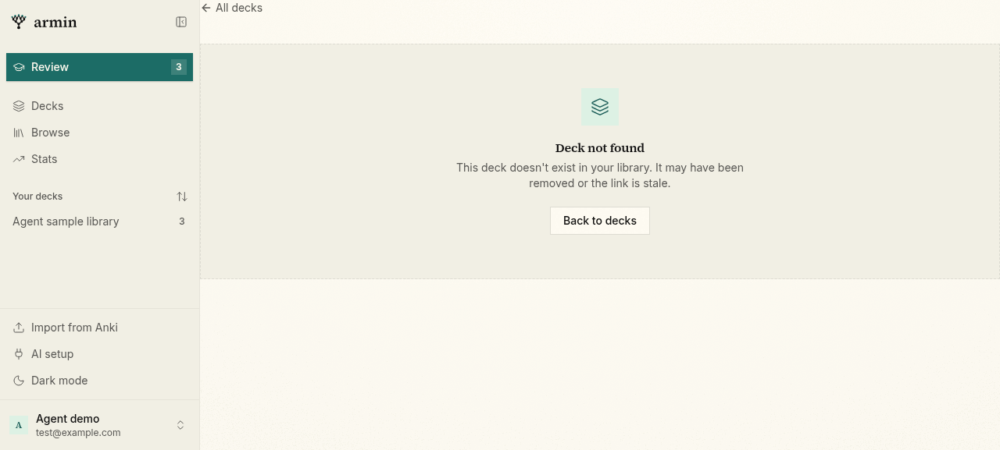
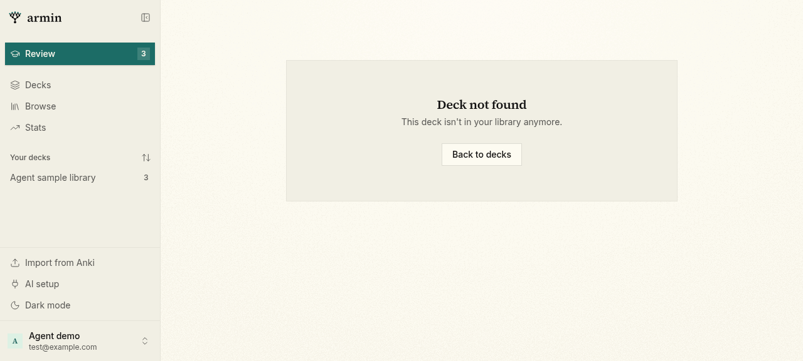
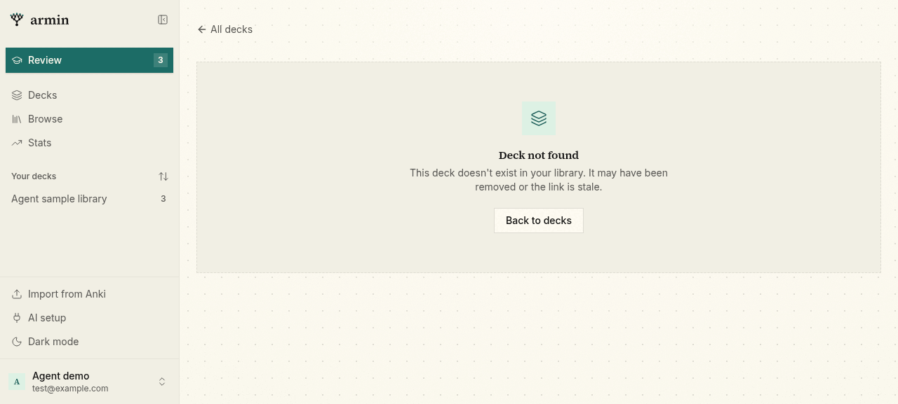

## 5. Scheduling settings inputs

Settings opened from the account menu (single `useSidebar` read). Results with
the shared `NumberSettingInput`:

| Field | Input | Result |
| --- | --- | --- |
| Desired retention | `5`, blur | Reset to `90`, marked invalid |
| Desired retention | `85x` | Typed as `85`; committed |
| Maximum interval | `12a,3`, blur | Typed as `12,3`; committed as `123` |
| Prerequisite stability | `1.5` | Committed |
| New review units per day | `2000` | Reset to `10`, marked invalid |
| Reviews per day | `200`, then empty | Committed `200`, then Unlimited (placeholder) |

**Reset to Balanced default settings** restored 90 / 36,500 / 2, and the
drafts followed the externally changed values.

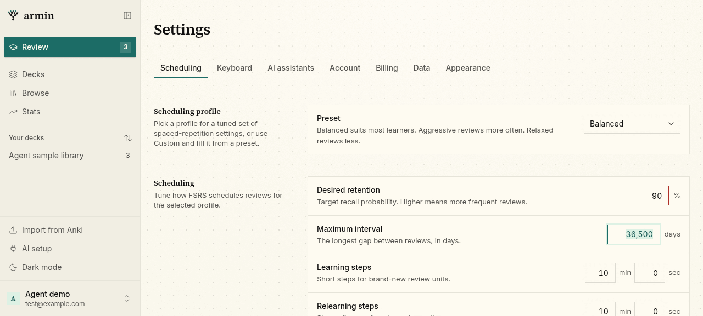

## 6. Keyboard

The Keyboard settings tab lists Navigation, General, Review; the `?`
cheatsheet lists the same groups in the same order (shared `COMMAND_GROUPS`).

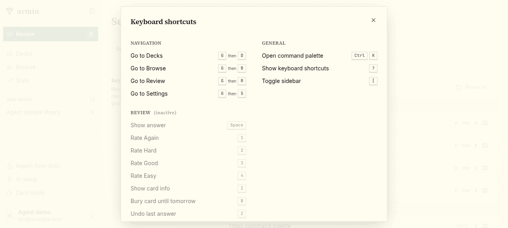

## 7. Anki import

- Browser import of the fixture: preview showed 300 cards in 1 deck with 20
  images; import completed with 300 cards, 1 deck, 300 past reviews.
- Converter equivalence: with the pre-change sources restored, the standalone
  control (`web-baseline.ts`) and the kit CLI were run on the same fixture, then
  again with the changes. The browser `planDigest` matched
  (`ac5263cc…`), and every kit output file (`plan.json`, `manifest.json`,
  `sources.json`, `preview.html`, media) was byte-identical. Kit 1.1.1 carries
  the rebuilt bundle.
- During the import, the dev log shows two `media:recordUpload` write
  conflicts on `libraryCounters` from parallel image uploads; the upload retry
  handled them and the import finished.

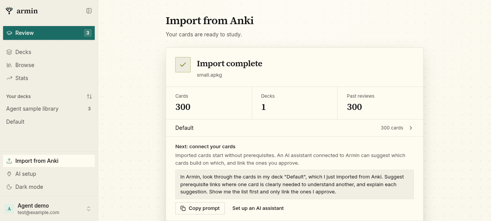

Not covered: the mobile app on a device (only the bundle check ran), the
assistant MCP import upload route (shares the reader but was not exercised),
exports, and the load-error panel (no failure was induced).
