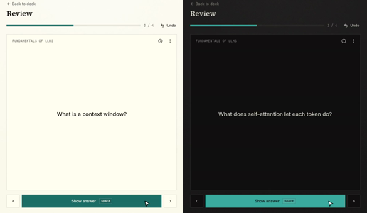
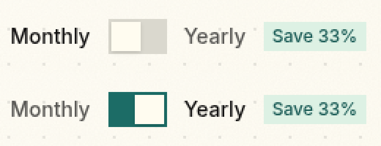

# Landing clips in light and dark

Running-app walkthrough on the worktree's local deployment
(`http://armin-adb30d63bf.localhost:34260/`, signed out), driven with
agent-browser in headless Chromium on Linux at an emulated 1440×900 viewport.

## What changed

The four landing clips were recorded only in dark mode, so a light-mode
visitor saw a dark block in the middle of a light page. Each clip now exists in
both schemes (`<clip>-light.mp4` / `<clip>-dark.mp4`, each with a JPEG poster),
and `LandingClip` renders both. CSS on `[data-theme=dark]` displays the one
that matches the page's resolved theme. The hidden one is `display: none`, so
it never intersects the viewport and never loads or plays.

`pnpm --filter @armin/web landing:clips` now records the full set once per
scheme. Two existing breakages in the recorder were fixed along the way: it
looked up the written card through the removed `flashcards.listByDeck` query
(now `graph.getDeck`), and it waited a fixed 1.2 s for the sign-in form instead
of the form itself.

## Checks

- Light (`prefers-color-scheme: light`): every displayed video is a `-light`
  source; the first clip plays when scrolled into view; no `-dark` video loaded
  (`readyState` 0).
- Dark: the reverse.
- Switching `data-theme` from dark to light with the page open: the light clip
  starts playing and the dark one pauses.

## Unlocked cards joining an open review session

While recording, the review clip often ended on "All caught up" although
grading Tokens unlocks Context window. Reproduced outside the recorder: after
the last card's grade, "All caught up" showed and the unlocked card appeared
1.5–4 s later (and once not within 10 s).

Cause: unlocking set the unit's due time to the server's clock at the unlock.
Queue queries compare due times with the client's study clock (`now`), which
only advances when `review.status` reports a `refreshAt`, with a 1 s minimum
delay plus any client-behind-server clock skew. So the unlocked unit counted
as "not yet due" for that open session until the clock caught up.

Fix (`applyLockState` in `packages/backend/convex/model/study.ts`): an
unlocked unit is due from its own creation time, the same due time a card
that was never locked has. Its availability then follows the `locked` data
change, which Convex pushes to the subscription immediately, not a time
comparison. Checked that this changes nothing else: new units are ordered by
`frontierKey`, not due; the forecast counts only Learning/Review/Relearning;
and ts-fsrs gives identical first-review outcomes for a new card whatever its
due date.

After the fix, three repro runs polled every ~150 ms: the unlocked card joined
the session about 0.5 s after the grade, every time. "All caught up" still
shows for ~0.4 s before it, because the session shows its end panel before the
last grade has saved; that is UI behavior, not part of this fix.

Both review clips were re-recorded and now end with an unlocked card in the
session. Context window and Self-attention unlock together; which one comes
first is a per-card hash that differs between recordings.

## Switch thumb spacing

The pricing page's Monthly/Yearly switch (the shared `Switch` in
`components/ui/switch.tsx`, also used in settings and dialogs) had an
off-centre thumb. The 18px thumb sat in a 20px inner track and slid 16px, so
the gap was 2px left and 3px top and bottom when off, and 4px right when on.
The thumb is now 20px: measured on `/pricing`, the gap is 2px on every side in
both states. Corners stay square, as everywhere in the app.

