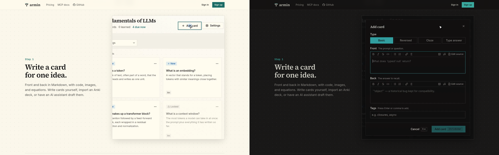
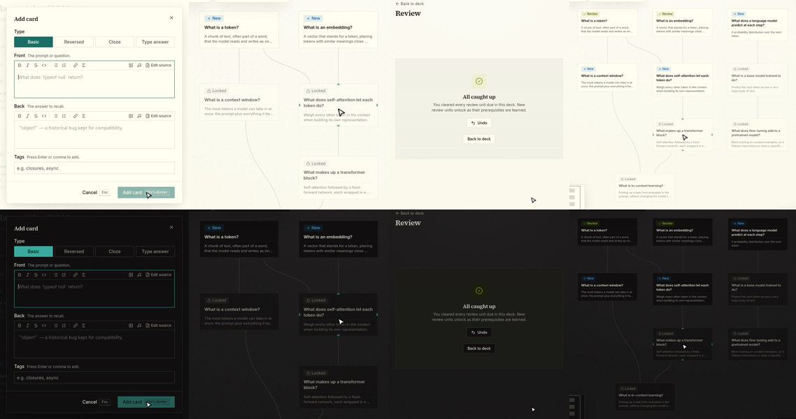

# Landing clips in light and dark

Running-app walkthrough on the worktree's local deployment
(`http://armin-adb30d63bf.localhost:34260/`, signed out), driven with
agent-browser in headless Chromium on Linux at an emulated 1440×900 viewport.

## What changed

The four landing clips were recorded only in dark mode, so a light-mode
visitor saw a dark block in the middle of a light page. Each clip now exists in
both schemes (`<clip>-light.mp4` / `<clip>-dark.mp4`, each with a JPEG poster),
and `LandingClip` renders both. CSS on `[data-theme=dark]` displays the one
that matches the page's resolved theme. The hidden one is `display: none`, so
it never intersects the viewport and never loads or plays.

`pnpm --filter @armin/web landing:clips` now records the full set once per
scheme. Two existing breakages in the recorder were fixed along the way: it
looked up the written card through the removed `flashcards.listByDeck` query
(now `graph.getDeck`), and it waited a fixed 1.2 s for the sign-in form instead
of the form itself.

## Checks

- Light (`prefers-color-scheme: light`): every displayed video is a `-light`
  source; the first clip plays when scrolled into view; no `-dark` video loaded
  (`readyState` 0).
- Dark: the reverse.
- Switching `data-theme` from dark to light with the page open: the light clip
  starts playing and the dark one pauses.

## Known issue in the recording

In the review clip, Context window sometimes did not join the session after
Tokens was graded, so the session ends on "All caught up". It varied between
recording runs; the committed set ends that way in both schemes. The step's
label doesn't mention the third card.
