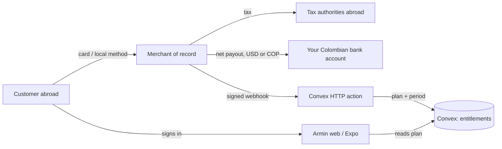

> Research note. Researched on 2026-10-27 against each provider's own documentation.
> No application code, dependencies, accounts, or credentials were changed.
> Provider eligibility and fees change without notice: re-check the linked page
> before committing. This is not tax or legal advice.

# Payment options for Armin, sold by a Colombian individual

Armin is a free beta today: no plan, no price, no billing code. The only revenue
limits are the beta quotas in
[`packages/backend/convex/model/limits.ts`](../../packages/backend/convex/model/limits.ts)
(200 decks, 2,000 cards, 120 agent writes/hour per connection). The web client
runs on Cloudflare Workers, the backend on Convex, and the Expo client is not yet
in the App Store or Play Store.

The seller is one person: a **persona natural** in Colombia, no SAS, no US entity.
That single constraint removes the default answer for most SaaS projects.

## Short answer

1. **Stripe is not available to a Colombian account.** Colombia is not on
   [Stripe's global availability list](https://stripe.com/global), which covers 46
   countries ([Stripe's own wording](https://stripe.com/use-cases/global-businesses)).
   Stripe Billing, Stripe Tax, and Stripe Managed Payments all inherit that gate.
2. **Use a merchant of record (MoR) for the global product.** Paddle is the safest
   default (Colombia is not on
   [Paddle's unsupported-seller list](https://www.paddle.com/help/start/intro-to-paddle/which-countries-are-supported-by-paddle),
   individuals are explicitly supported, 200+ buyer countries, PayPal and local
   methods). Dodo is the value challenger with the broadest method list; Creem is
   cheaper but cards-and-wallets only; Polar and Lemon Squeezy are backups. The MoR
   is the legal seller: it charges the customer, handles VAT/GST/sales tax, refunds,
   and chargebacks, and pays you a net amount, so Armin never registers for tax in
   30 countries.
3. **Judge every option by global coverage and by whether it can pay you.** Two
   families fail that test and are out of the table: Colombian gateways cannot
   serve buyers abroad, and Stripe cannot open a seller account for a Colombian
   individual. Every remaining option charges customers in 190+ countries and
   settles to a Colombian bank account.
4. **Do not build app-store billing yet.** The Expo app is not distributed; when it
   is, digital subscriptions must go through in-app purchase (15% under the Small
   Business Program) or the app can simply let an existing subscriber sign in.
5. **Bill yearly by default.** At a $5 monthly price, the fixed per-transaction fee
   eats 8–10% of revenue; yearly billing cuts the blended fee roughly in half.
6. **At 25 paying subscribers you keep $104–110 a month, not $125.** Platform fees
   are $15–21; payout fees add $2–15 more depending on the rail. The low-volume
   projections below are the realistic starting picture.

## How the money would flow

The whole integration surface is: a hosted checkout redirect, one webhook endpoint,
one entitlements table, and a "manage subscription" link. Everything else (tax,
invoices, dunning, disputes) is the MoR's job.

## Option comparison for a global product

Fees are the published all-in rate for a card payment. MoRs charge on the gross
amount including tax, so a 19% VAT sale costs slightly more than the percentage
suggests, and international-card surcharges (where they exist) appear in the fee
table below. "Colombian individual" means a natural person with no registered
company, verified with a cedula/passport and a personal bank account.

| Option                             | Who is the seller | Colombian individual                                                                                                                                                                                                                                        | Buyer coverage                                                                           | Non-card / local methods                                                                                                                                                                                           | Price localization                                                       | Fee (published)                                                                                                     | Payout to Colombia                                              | Fit for a global launch                                                                                                                |
| ---------------------------------- | ----------------- | ----------------------------------------------------------------------------------------------------------------------------------------------------------------------------------------------------------------------------------------------------------- | ---------------------------------------------------------------------------------------- | ------------------------------------------------------------------------------------------------------------------------------------------------------------------------------------------------------------------ | ------------------------------------------------------------------------ | ------------------------------------------------------------------------------------------------------------------- | --------------------------------------------------------------- | -------------------------------------------------------------------------------------------------------------------------------------- |
| **Paddle**                         | Paddle            | Yes ([not on unsupported list](https://www.paddle.com/help/start/intro-to-paddle/which-countries-are-supported-by-paddle); [no business verification for individuals](https://www.paddle.com/help/start/account-verification/what-is-account-verification)) | [200+ countries](https://developer.paddle.com/concepts/sell/supported-countries-locales) | PayPal, iDEAL/Wero, Bancontact, BLIK, MB WAY, Pix, UPI, Alipay, WeChat, Korean wallets and cards, wire ([full list](https://developer.paddle.com/concepts/payment-methods))                                        | Country-specific prices plus automatic currency conversion, COP included | [5% + $0.50](https://www.paddle.com/pricing)                                                                        | Monthly, min $100, wire (USD, ~$15 SWIFT) or Payoneer           | **Best default**: widest method mix with the least tax work; one-month payout lag                                                      |
| **Dodo Payments**                  | Dodo              | Yes ([accepted countries](https://docs.dodopayments.com/miscellaneous/accepted-countries-and-territories))                                                                                                                                                  | [220+ countries](https://docs.dodopayments.com/introduction)                             | [40+ methods](https://docs.dodopayments.com/features/payment-methods): iDEAL, Bancontact, BLIK, EPS, Multibanco, Pix, UPI, Klarna, Afterpay, Korean wallets, Alipay HK, GCash, stablecoins; PayPal temporarily off | Adaptive currency in 80+ currencies                                      | [4% + $0.40, +1.5% intl cards, +0.5% subscriptions](https://dodopayments.com/pricing)                               | Bi-monthly, $50 minimum                                         | **Value challenger**: cheapest broad-coverage option at low prices; youngest provider                                                  |
| **Creem**                          | Creem             | Yes ([Colombia listed, bank-partner restriction flagged](https://docs.creem.io/merchant-of-record/supported-countries))                                                                                                                                     | [190+ countries for tax](https://docs.creem.io/getting-started/introduction)             | Cards, Apple Pay, Google Pay only ([methods](https://docs.creem.io/merchant-of-record/finance/payment-methods)); PayPal "coming soon"                                                                              | Charged in the customer's currency                                       | [3.9% + $0.40](https://www.creem.io/pricing)                                                                        | 1st and 15th, min $50, bank transfer ($7 or 1%) or USDC         | Lowest fee, but cards-only checkout will cost conversions in Europe, Brazil, and India                                                 |
| **Polar**                          | Polar             | Yes ([Colombia on the payout list](https://polar.sh/docs/merchant-of-record/supported-countries))                                                                                                                                                           | Global except sanctioned countries                                                       | Cards, Apple/Google Pay, Link, Amazon Pay (US/DE), Cash App, WeChat, iDEAL, Bancontact, EPS, UPI, Korean wallets; **no PayPal** ([methods](https://polar.sh/docs/features/checkout/payment-methods))               | Per-product currency                                                     | [5% + $0.50 Starter, +1.5% non-US cards](https://polar.sh/docs/merchant-of-record/fees)                             | Stripe Connect Express, manual withdrawals                      | Good developer fit; no PayPal and thinner local coverage                                                                               |
| **Lemon Squeezy**                  | Lemon Squeezy     | Yes ([COP bank payouts](https://docs.lemonsqueezy.com/help/getting-started/supported-countries))                                                                                                                                                            | Global except the unsupported list                                                       | 16 methods including PayPal ([fees](https://docs.lemonsqueezy.com/help/getting-started/fees))                                                                                                                      | 95 currencies                                                            | 5% + $0.50, +1.5% intl, +0.5% subscriptions                                                                         | Twice monthly, 13-day hold, $50 min                             | Solid today, but being absorbed into Stripe Managed Payments, which [excludes Colombia](https://www.lemonsqueezy.com/blog/2026-update) |
| **Gumroad**                        | Gumroad           | Yes (COP payouts, min COP 140,000)                                                                                                                                                                                                                          | Global                                                                                   | Cards and PayPal                                                                                                                                                                                                   | Local payout currency only                                               | [10% + $0.50 plus card processing](https://gumroad.com/pricing)                                                     | Weekly-ish, per-market minimums                                 | ~25-29% on a $5 sale; only for a one-off supporter purchase                                                                            |
| **Apple / Google in-app purchase** | Apple / Google    | Yes ([Apple individual, $99/yr](https://developer.apple.com/help/account/membership/program-enrollment/); [Play merchant registration](https://support.google.com/googleplay/android-developer/answer/7161440))                                             | Worldwide storefronts                                                                    | Store wallets, carrier billing, local methods per storefront                                                                                                                                                       | Store price tiers per country                                            | 15% with the [Small Business Program](https://developer.apple.com/app-store/small-business-program/), 30% otherwise | Apple: COP bank, min $100, ~45 days. Google: USD wire, min $100 | Mandatory only for digital sales _inside_ a store-distributed app; not a web strategy                                                  |
| **PayPal (standalone)**            | You               | Yes ([COP withdrawals COP 3,500](https://www.paypal.com/co/digital-wallet/paypal-consumer-fees))                                                                                                                                                            | 200+ markets                                                                             | PayPal balance, cards                                                                                                                                                                                              | Buyer's currency                                                         | ~3.4% + fixed, plus 3.5-4.5% conversion                                                                             | COP 3,500 per withdrawal                                        | Useful as an extra button, not as the billing system: no dunning, proration, or tax handling                                           |

Excluded by the international + Colombia-payout test: Mercado Pago, Wompi,
ePayco, and PayU (buyers must pay in COP through Colombian rails) and Stripe (no
Colombian seller account; a US LLC would pay out to a US bank, not Colombia).

### What "international" changes

- **Coverage is the first filter, not the fee.** Every option left can charge a
  customer in 190+ countries and settle to a Colombian bank account; that pair is
  what removed the local gateways and Stripe.
- **Local methods and PayPal are conversion features.** Cards-only is the most
  common reason a European or Brazilian buyer abandons. Paddle, Dodo, and Lemon
  Squeezy ship PayPal and local rails; Creem and Polar do not (yet).
- **Presentment currency matters.** Auto-converting a USD price to EUR, GBP, BRL,
  or INR measurably helps; all three broad MoRs do it, with country-level price
  overrides where you want them.
- **Tax registration drift is the real risk.** Selling worldwide without an MoR
  means EU OSS, UK VAT, and US state sales-tax registrations - the work grows with
  success, which is exactly when you have no time for it.
- **The MoR also absorbs EU withdrawal rights, B2B VAT invoices, and dunning.**
  Those are three small features that each cost a week of engineering otherwise.

## What the fee actually costs on this product

Assumes a $5/month price or a $48/year price, an international (non-US) card, and
no tax in the base. MoRs charge on the tax-inclusive amount, so add roughly the
customer's tax rate to the real cost.

| Provider                                          | Fee on $5 monthly | Effective | Fee on $48 yearly | Effective |
| ------------------------------------------------- | ----------------- | --------- | ----------------- | --------- |
| Creem                                             | $0.60             | 11.9%     | $2.27             | 4.7%      |
| Dodo (4% + 1.5% intl + 0.5% subscription + $0.40) | $0.70             | 14.0%     | $3.28             | 6.8%      |
| Paddle                                            | $0.75             | 15.0%     | $2.90             | 6.0%      |
| Polar Starter (+1.5% intl)                        | $0.83             | 16.5%     | $3.62             | 7.5%      |
| Lemon Squeezy (+1.5% intl, +0.5% subscriptions)   | $0.85             | 17.0%     | $3.86             | 8.0%      |
| Gumroad (10% + $0.50 + 2.9% + $0.30)              | $1.45             | 28.9%     | $6.99             | 14.6%     |
| Apple / Google (15%)                              | $0.75             | 15.0%     | $7.20             | 15.0%     |

Three conclusions:

- The spread between MoRs at this price point is about four points. The gap
  between offering PayPal and local methods and not offering them is larger than
  that, because it decides whether the sale happens at all.
- Yearly billing more than halves the percentage fee, and it matches how people use
  a spaced-repetition app: a semester, not a month.
- Cards-only providers can look cheapest per transaction and be the most expensive
  per customer.

### Pricing the international catalogue

- **USD is the base price.** Australian, Canadian, and most Asian buyers are used
  to seeing USD; the MoR converts the rest automatically.
- **Set explicit EUR and GBP prices** (for example 5 EUR and 4 GBP) instead of letting a
  straight conversion land on 4.63 EUR. Round numbers convert better and are
  expected in those markets.
- **Show tax-inclusive prices in the EU and UK**, tax-exclusive in the US and
  Canada. Both Paddle and Dodo resolve this from the billing address.
- **Discount for purchasing power where it matters** (Brazil, India, Turkey) with a
  country price rather than a coupon, so the checkout stays one click.
- **Anchor annual.** A 40-48 USD yearly price against 5-6 USD monthly keeps the
  fee under 7% and matches a semester of study.
- **Colombian buyers** pay USD at their card's exchange rate. A COP catalogue
  would need a gateway that cannot serve the rest of the audience, so keep one USD
  price list.

## Revenue projections at a low starting volume

These are deliberately pessimistic: five to a hundred paying subscribers, which is
what a free beta converts into if one to five percent of active users ever pay.

Assumptions:

- One plan, priced at **$5/month or $48/year** (20% off for paying up front).
- **International card**, so the international-card surcharges below are included.
- **USD/COP at COP 3,157.94**, the TRM published for 27 October 2026.
- Platform fees only. VAT/sales tax is not revenue to you and is excluded; payout
  fees, bank charges, and Colombian income tax are in the next table, not this one.
- Fees are `percentage × revenue + fixed × subscribers`: Paddle 5% + $0.50, Dodo
  6% + $0.40 (4% + 1.5% international + 0.5% subscription), Creem 3.9% + $0.40,
  Polar 6.5% + $0.50, Lemon Squeezy 7% + $0.50, Gumroad 12.9% + $0.80, Apple and
  Google 15%, PayPal 7.9% + $0.30 (cross-border plus conversion, approximate).

### Monthly plan at $5

| Provider       | 5 subs · $25       | 10 subs · $50       | 25 subs · $125       | 50 subs · $250       | 100 subs · $500       |
| -------------- | ------------------ | ------------------- | -------------------- | -------------------- | --------------------- |
| Paddle         | $3.75 · COP 11,842 | $7.50 · COP 23,685  | $18.75 · COP 59,211  | $37.50 · COP 118,423 | $75.00 · COP 236,846  |
| Dodo           | $3.50 · COP 11,053 | $7.00 · COP 22,106  | $17.50 · COP 55,264  | $35.00 · COP 110,528 | $70.00 · COP 221,056  |
| Creem          | $2.98 · COP 9,395  | $5.95 · COP 18,790  | $14.88 · COP 46,974  | $29.75 · COP 93,949  | $59.50 · COP 187,897  |
| Polar          | $4.13 · COP 13,027 | $8.25 · COP 26,053  | $20.63 · COP 65,133  | $41.25 · COP 130,265 | $82.50 · COP 260,530  |
| Lemon Squeezy  | $4.25 · COP 13,421 | $8.50 · COP 26,842  | $21.25 · COP 67,106  | $42.50 · COP 134,212 | $85.00 · COP 268,425  |
| Gumroad        | $7.22 · COP 22,816 | $14.45 · COP 45,632 | $36.12 · COP 114,081 | $72.25 · COP 228,161 | $144.50 · COP 456,322 |
| Apple / Google | $3.75 · COP 11,842 | $7.50 · COP 23,685  | $18.75 · COP 59,211  | $37.50 · COP 118,423 | $75.00 · COP 236,846  |
| PayPal         | $3.48 · COP 10,974 | $6.95 · COP 21,948  | $17.38 · COP 54,869  | $34.75 · COP 109,738 | $69.50 · COP 219,477  |

### Annual plan at $48

Cash collected once per subscriber; the COP column is the fee converted at the
same TRM, not a yearly average.

| Provider       | 5 subs · $240        | 10 subs · $480       | 25 subs · $1,200      | 50 subs · $2,400        | 100 subs · $4,800       |
| -------------- | -------------------- | -------------------- | --------------------- | ----------------------- | ----------------------- |
| Paddle         | $14.50 · COP 45,790  | $29.00 · COP 91,580  | $72.50 · COP 228,951  | $145.00 · COP 457,901   | $290.00 · COP 915,803   |
| Dodo           | $16.40 · COP 51,790  | $32.80 · COP 103,580 | $82.00 · COP 258,951  | $164.00 · COP 517,902   | $328.00 · COP 1,035,804 |
| Creem          | $11.36 · COP 35,874  | $22.72 · COP 71,748  | $56.80 · COP 179,371  | $113.60 · COP 358,742   | $227.20 · COP 717,484   |
| Polar          | $18.10 · COP 57,159  | $36.20 · COP 114,317 | $90.50 · COP 285,794  | $181.00 · COP 571,587   | $362.00 · COP 1,143,174 |
| Lemon Squeezy  | $19.30 · COP 60,948  | $38.60 · COP 121,896 | $96.50 · COP 304,741  | $193.00 · COP 609,482   | $386.00 · COP 1,218,965 |
| Gumroad        | $34.96 · COP 110,402 | $69.92 · COP 220,803 | $174.80 · COP 552,008 | $349.60 · COP 1,104,016 | $699.20 · COP 2,208,032 |
| Apple / Google | $36.00 · COP 113,686 | $72.00 · COP 227,372 | $180.00 · COP 568,429 | $360.00 · COP 1,136,858 | $720.00 · COP 2,273,717 |
| PayPal         | $20.46 · COP 64,611  | $40.92 · COP 129,223 | $102.30 · COP 323,057 | $204.60 · COP 646,115   | $409.20 · COP 1,292,229 |

### What actually lands, at 25 subscribers

| Provider       | Monthly plan: fee → net        | Annual plan: fee → net (per year)   |
| -------------- | ------------------------------ | ----------------------------------- |
| Paddle         | $18.75 → $106.25 (COP 335,531) | $72.50 → $1,127.50 (COP 3,560,577)  |
| Dodo           | $17.50 → $107.50 (COP 339,479) | $82.00 → $1,118.00 (COP 3,530,577)  |
| Creem          | $14.88 → $110.12 (COP 347,768) | $56.80 → $1,143.20 (COP 3,610,157)  |
| Polar          | $20.63 → $104.37 (COP 329,603) | $90.50 → $1,109.50 (COP 3,503,734)  |
| Lemon Squeezy  | $21.25 → $103.75 (COP 327,636) | $96.50 → $1,103.50 (COP 3,484,787)  |
| Gumroad        | $36.12 → $88.88 (COP 280,662)  | $174.80 → $1,025.20 (COP 3,237,520) |
| Apple / Google | $18.75 → $106.25 (COP 335,531) | $180.00 → $1,020.00 (COP 3,221,099) |
| PayPal         | $17.38 → $107.62 (COP 339,873) | $102.30 → $1,097.70 (COP 3,466,471) |

### Fixed and payout costs to budget

These are the costs the percentage tables hide, and at this volume they can match
or exceed the platform fee.

| Provider      | Fixed cost           | Payout cost at 25 subscribers                                                 |
| ------------- | -------------------- | ----------------------------------------------------------------------------- |
| Paddle        | None                 | ~$15 per wire payout, paid monthly: ~$180/year; Payoneer is roughly 1-2%      |
| Dodo          | None                 | Deducted per payout; the docs do not publish the amount — check the dashboard |
| Creem         | None                 | $7 per payout or 1%, twice monthly, so ~$168/year at this volume              |
| Polar         | None                 | $2/month active + 0.25% + $0.25 per payout, ~$27/year, plus 0.25-1% FX        |
| Lemon Squeezy | None                 | 1% per payout, ~$11/year                                                      |
| Gumroad       | None                 | Not published; per-market payout minimums apply                               |
| Apple         | $99/year program fee | No Apple payout fee; COP 100 minimum, payments ~45 days after month end       |
| Google        | $25 one-time         | Wire fees charged by your bank, $0-50                                         |
| PayPal        | None                 | COP 3,500 per withdrawal, ~$13/year at monthly withdrawals                    |

### Reading the projections

- **At 25 monthly subscribers ($125/month) the platform takes $15-21, or 12-17%.**
  With the payout rail included, Paddle lands near $92 kept and Creem near $96.
  That is the honest starting number, not $125.
- **Payout fees dominate before platform fees do.** A $15 wire on $106 of proceeds
  is another 14 points. Use Payoneer or a 1% payout where the provider allows it,
  and do not withdraw more often than you need to.
- **Annual billing is where the margin is.** The same 25 subscribers paying $48
  up front produce $1,200 and a $57-97 fee (4.7-8%), before payout costs.
- **Below $50/month, several providers cannot pay you at all.** Paddle's default
  minimum is $100, Creem and Dodo $50. Early revenue accumulates as a balance.
- **The store is the worst deal at this scale.** Apple charges $99/year plus 15%:
  at 5 annual subscribers that is $135 of a $240 year, and at 100 it is still 18%.
- **Nothing here includes Colombian income tax, the 4x1,000 tax, or bank fees.**
  Those come out of the net figures above.

## Recommendation

**Primary: Paddle, with Dodo as the fee challenger and Creem only if you accept a
cards-only checkout.**

Reasons for Paddle over the others:

- It is a real MoR: no tax registrations abroad, buyer invoices, or chargeback
  defence for a one-person operation.
- Individuals are a supported account type, and business registration documents
  are explicitly not required for them.
- Colombia is not on the unsupported-seller list, and payouts reach Colombian
  banks by wire or Payoneer.
- It covers 200+ buyer countries with PayPal, iDEAL/Wero, Bancontact, BLIK, Pix,
  UPI, Alipay, WeChat, and the Korean wallets — the method mix that turns a global
  audience into paying customers.
- It auto-converts to local currencies and supports country-specific prices, so
  the same catalogue can show USD to a US buyer and EUR to a German one.
- Armin is consumer software, which fits Paddle's acceptable-use policy (no
  physical goods, no human services, no donations).

The trade-offs to accept: 5% + $0.50, monthly payouts with a one-month lag, and a
website that must show pricing, terms, privacy, and a refund policy before
approval. Armin already has [terms](../../apps/web/src/routes/terms.tsx) and
[privacy](../../apps/web/src/routes/privacy.tsx); a pricing page is missing.

**Run a two-week checkout comparison with Dodo if fee drag matters.** It is a
third cheaper than Paddle per transaction (4% + $0.40 versus 5% + $0.50), covers
220+ countries, carries the widest local-method list of any option here, and pays
out twice a month. The reason it is not the default is maturity: fewer years, a
smaller support surface, PayPal temporarily disabled. Because both Paddle and Dodo
are hosted-checkout MoRs, testing one and switching the other costs a webhook URL
and a product id, not a rewrite.

**Creem is the cheapest per transaction (3.9% + $0.40) but only if cards and
wallets are enough.** For a global launch they usually are not: no PayPal, and no
local rails in the markets where cards underperform.

**Excluded by your own payout test.** Colombian gateways cannot charge buyers
outside Colombia, and Stripe has no Colombian seller account; a US LLC would pay
out to a US bank, not to Colombia. If a US entity ever becomes worth its filings,
Stripe re-enters as a separate project, not as an upgrade to this one.

**Mobile: no in-app purchase until the app is in a store.** If and when it ships,
the cheapest compliant setup is:

- sell on the web (MoR), and let the app say "already subscribed? sign in" — allowed
  for multi-platform services, with no link out;
- if you do sell inside the app, enrol in the Small Business Program (15%) and
  expect a second, store-specific price catalogue.

## Colombian side: what the individual has to do

Not tax advice — the point is to know which questions to ask, and to see why the
MoR route is simpler than being the seller yourself.

| Item                  | What applies                                                                                                                                                                                                                                                                                           | Why it matters here                                                                     |
| --------------------- | ------------------------------------------------------------------------------------------------------------------------------------------------------------------------------------------------------------------------------------------------------------------------------------------------------ | --------------------------------------------------------------------------------------- |
| RUT                   | Register the economic activity (software/digital services CIIU) with your cédula                                                                                                                                                                                                                       | Every gateway and MoR payout asks for it; needed to invoice the MoR                     |
| Export of services    | Sales through an MoR are an export: exempt/0% VAT when the service is used exclusively abroad by a party with no business in Colombia (art. 481 lit. c E.T.)                                                                                                                                           | Avoids charging 19% VAT on a global SaaS; keep the MoR contract and invoices as support |
| Exporter registration | To claim the export treatment, the RUT needs the exporter-of-services fields (responsibility 48 + 19, customs user 10, export type "services", cross-border mode), per [Decreto 2223/2013 and DIAN Concepto 8660/2024](https://normograma.dian.gov.co/dian/compilacion/docs/oficio_dian_8660_2024.htm) | This is the step people miss; without it the 0% rate is contestable                     |
| VAT responsibility    | Not responsible below 3,500 UVT with the other art. 437 conditions met — 3,500 × COP 52,374 = **COP 183.3M** for 2026 ([UVT 2026](https://www.dian.gov.co/normatividad/Normatividad/Resoluci%C3%B3n%20000238%20de%2015-12-2025.pdf))                                                                   | At beta scale you likely stay under this; crossing it changes pricing and invoicing     |
| Electronic invoicing  | Required when VAT-responsible, in SIMPLE, or above 3,500 UVT ([DIAN](https://www.dian.gov.co/impuestos/factura-electronica/como-hacerlo/Paginas/ser-facturador-electronico.aspx))                                                                                                                      | In practice: invoice the MoR (export) rather than thousands of consumers                |
| Income tax            | Business income ("rentas no laborales"); annual return once thresholds are met (1,400 UVT ≈ COP 73.3M with the 2026 UVT)                                                                                                                                                                               | MoR payouts land as gross income, not profit; keep fee and FX records                   |
| SIMPLE vs ordinary    | SIMPLE group 3 (professional services) runs 5.9%–14.5% consolidated after [Sentencia C-540/2023](https://micrositios.dian.gov.co/regimen-simple-tributacion/preguntas-frecuentes/)                                                                                                                     | Worth modelling with an accountant once revenue is real; SIMPLE also forces invoicing   |
| FX and bank fees      | Payouts arrive in USD (wire) or are converted by the MoR; the 4×1,000 GMF applies to local movements                                                                                                                                                                                                   | A USD account at a Colombian bank or a Payoneer/Wise layer reduces conversion loss      |
| US tax form           | MoRs and Apple/Google ask for a W-8BEN as a foreign individual                                                                                                                                                                                                                                         | Straightforward; keep the treaty/residence answers consistent across providers          |

One more consequence of the MoR model: **your customers are the MoR's customers**.
You see net payouts and a subscription list, not card data, and refunds and
chargebacks are handled for you. That is the trade you are making for the 5%.

## Integration sketch for this codebase

Small enough to keep inside the existing architecture:

1. **Entitlements in Convex.** A `plans` row per account: provider, customer id,
   subscription id, status, `currentPeriodEnd`, and the plan key. Queries that
   already enforce beta quotas read it instead of the constants.
2. **One HTTP action** in `packages/backend/convex/http.ts` (it already registers
   the agent routes and media routes) for the webhook: verify the signature, dedupe
   on event id, then call a single mutation that upserts the entitlement. Portal and
   checkout URLs are created in an action, never in the client.
3. **Web:** a `/pricing` route, a "Manage subscription" link in Settings that opens
   the MoR customer portal, and a "restore purchase" path for the app.
4. **Mobile:** no store kit in the first pass; show plan status and a link-free
   "subscribe on the web" instruction (store policies differ per storefront, so
   check the current rules before adding any link).
5. **Gating:** reuse the existing limits. A sensible split is free = 5 decks /
   300 cards; paid = the current 200 / 2,000 caps plus higher agent write limits.
   Nothing in the schema needs to change to enforce this beyond reading the plan.
6. **Failure modes to design for:** webhook retries, out-of-order events, a lapsed
   subscription during a review session (grace period), and refunds that must not
   delete study data.

## What to verify before committing

Ask each provider these, in writing, before building:

- Does an individual (not a company) with a Colombian cédula pass KYC, and is the
  payout account required to be in my own name?
- Is a spaced-repetition study SaaS inside the acceptable-use policy (education /
  consumer software, no physical goods, no human services)?
- Which countries can buyers pay from, and which are blocked by sanctions or
  partner policy? (Ask for the API endpoint or page you can re-check later.)
- Which payment methods are actually shown per market — cards only, or PayPal,
  iDEAL/Wero, Bancontact, Pix, UPI, Alipay, Korean wallets?
- Can I set country-specific prices and presentment currencies, and does the
  checkout show tax-inclusive prices where local convention expects it?
- Which tax jurisdictions do you file and remit in, and what do I still owe the
  DIAN on an export of services?
- Which payout rails reach Colombia, in which currency, with which fee and minimum?
- What is the refund and chargeback policy, and who absorbs the loss? Do you handle
  the EU 14-day withdrawal right and B2B VAT invoices?
- What do you need on the website before approval (pricing page, refund policy,
  terms, contact)?
- Is there a sandbox with test cards, and does it emit the same webhook events as
  production?

## Sources

Stripe: [global availability](https://stripe.com/global) (used only for the exclusion note).
Paddle: [unsupported seller countries](https://www.paddle.com/help/start/intro-to-paddle/which-countries-are-supported-by-paddle), [individual verification](https://www.paddle.com/help/start/account-verification/what-is-account-verification), [pricing](https://www.paddle.com/pricing), [payouts](https://www.paddle.com/help/start/intro-to-paddle/when-and-how-do-i-get-paid), [accepted countries and currencies](https://developer.paddle.com/concepts/sell/supported-countries-locales).
Paddle methods: [payment methods](https://developer.paddle.com/concepts/payment-methods), [supported countries and currencies](https://developer.paddle.com/concepts/sell/supported-countries-locales).
Creem: [supported countries](https://docs.creem.io/merchant-of-record/supported-countries), [pricing](https://www.creem.io/pricing), [payouts](https://docs.creem.io/merchant-of-record/finance/payouts), [payment methods](https://docs.creem.io/merchant-of-record/finance/payment-methods).
Polar: [supported countries](https://polar.sh/docs/merchant-of-record/supported-countries), [fees](https://polar.sh/docs/merchant-of-record/fees), [payout accounts](https://polar.sh/docs/features/finance/accounts), [payment methods](https://polar.sh/docs/features/checkout/payment-methods).
Dodo: [accepted countries](https://docs.dodopayments.com/miscellaneous/accepted-countries-and-territories), [pricing](https://dodopayments.com/pricing), [payment methods](https://docs.dodopayments.com/features/payment-methods), [countries for buyers](https://docs.dodopayments.com/miscellaneous/list-of-countries-we-accept-payments-from).
Lemon Squeezy: [supported countries](https://docs.lemonsqueezy.com/help/getting-started/supported-countries), [fees](https://docs.lemonsqueezy.com/help/getting-started/fees), [2026 status update](https://www.lemonsqueezy.com/blog/2026-update).
Gumroad: [fees](https://gumroad.com/help/article/66-gumroads-fees), [payouts by country](https://gumroad.com/help/article/13-getting-paid).
PayPal: [consumer fees, Colombia](https://www.paypal.com/co/digital-wallet/paypal-consumer-fees).
Apple: [individual enrollment](https://developer.apple.com/help/account/membership/program-enrollment/), [Small Business Program](https://developer.apple.com/app-store/small-business-program/), [minimum payment thresholds](https://developer.apple.com/help/app-store-connect/reference/minimum-payment-threshold/), [EU payment options](https://developer.apple.com/support/payment-options-on-the-app-store-in-the-eu/).
Google: [supported locations](https://support.google.com/googleplay/android-developer/answer/9306917), [Colombia merchant bank details](https://support.google.com/googleplay/android-developer/answer/7161440), [wire payouts](https://support.google.com/googleplay/android-developer/answer/2700656).
DIAN: [UVT 2026](https://www.dian.gov.co/normatividad/Normatividad/Resoluci%C3%B3n%20000238%20de%2015-12-2025.pdf), [electronic invoicing](https://www.dian.gov.co/impuestos/factura-electronica/como-hacerlo/Paginas/ser-facturador-electronico.aspx), [VAT responsibility thresholds](https://www.dian.gov.co/atencionciudadano/contactenos/Annimos%20PQRS/Respuesta-2026DP000161206-2026.pdf), [exporter-of-services RUT registration](https://normograma.dian.gov.co/dian/compilacion/docs/oficio_dian_8660_2024.htm), [SIMPLE rates](https://micrositios.dian.gov.co/regimen-simple-tributacion/tarifas-rst/).
