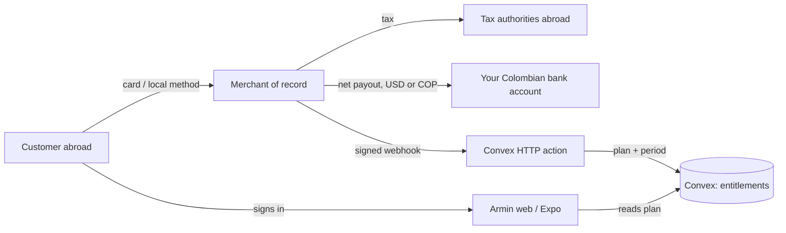

> Research note. Researched on 2026-10-27 against each provider's own documentation.
> No application code, dependencies, accounts, or credentials were changed.
> Provider eligibility and fees change without notice: re-check the linked page
> before committing. This is not tax or legal advice.

# Payment options for Armin, sold by a Colombian individual

Armin is a free beta today: no plan, no price, no billing code. The only revenue
limits are the beta quotas in
[`packages/backend/convex/model/limits.ts`](../../packages/backend/convex/model/limits.ts)
(200 decks, 2,000 cards, 120 agent writes/hour per connection). The web client
runs on Cloudflare Workers, the backend on Convex, and the Expo client is not yet
in the App Store or Play Store.

The seller is one person: a **persona natural** in Colombia, no SAS, no US entity.
That single constraint removes the default answer for most SaaS projects.

## Short answer

1. **Stripe is not available to a Colombian account.** Colombia is not on
   [Stripe's global availability list](https://stripe.com/global), which covers 46
   countries ([Stripe's own wording](https://stripe.com/use-cases/global-businesses)).
   Stripe Billing, Stripe Tax, and Stripe Managed Payments all inherit that gate.
2. **Use a merchant of record (MoR) for the global product.** Paddle is the safest
   default (Colombia is not on
   [Paddle's unsupported-seller list](https://www.paddle.com/help/start/intro-to-paddle/which-countries-are-supported-by-paddle),
   individuals are explicitly supported). Creem is the cheaper alternative, and
   Polar, Dodo, and Lemon Squeezy are viable backups. The MoR is the legal seller:
   it charges the customer, handles VAT/GST/sales tax, refunds, and chargebacks,
   and pays you a net amount, so Armin never registers for tax in 30 countries.
3. **Skip local Colombian gateways unless you actually price for Colombia.**
   Mercado Pago (or Wompi/ePayco) only helps customers who want to pay in COP with
   PSE, Nequi, Daviplata, or Efecty. For an app whose audience is mostly outside
   Colombia, they add a second billing path for very little revenue.
4. **Do not build app-store billing yet.** The Expo app is not distributed; when it
   is, digital subscriptions must go through in-app purchase (15% under the Small
   Business Program) or the app can simply let an existing subscriber sign in.
5. **Bill yearly by default.** At a $5 monthly price, the fixed per-transaction fee
   eats 8–10% of revenue; yearly billing cuts the blended fee roughly in half.

## How the money would flow

The whole integration surface is: a hosted checkout redirect, one webhook endpoint,
one entitlements table, and a "manage subscription" link. Everything else (tax,
invoices, dunning, disputes) is the MoR's job.

## Option comparison

Fees are the provider's published all-in rate for a card payment; MoRs charge on
the gross amount including tax, so a 19% VAT sale costs slightly more than the
percentage suggests. "Individual" means a natural person with no registered
company, verified with a cédula/passport and a personal bank account.

| Option                    | Who is the seller | Colombian individual                                                                                                                                                                                                                                                  | Subscriptions                                                                                                                           | Fee (published)                                                                                                              | Payout                                                                   | Main trade-off                                                                                                                              |
| ------------------------- | ----------------- | --------------------------------------------------------------------------------------------------------------------------------------------------------------------------------------------------------------------------------------------------------------------- | --------------------------------------------------------------------------------------------------------------------------------------- | ---------------------------------------------------------------------------------------------------------------------------- | ------------------------------------------------------------------------ | ------------------------------------------------------------------------------------------------------------------------------------------- |
| **Paddle**                | Paddle            | Yes ([not on unsupported list](https://www.paddle.com/help/start/intro-to-paddle/which-countries-are-supported-by-paddle); [business verification not required for individuals](https://www.paddle.com/help/start/account-verification/what-is-account-verification)) | Yes, full billing                                                                                                                       | [5% + $0.50](https://www.paddle.com/pricing)                                                                                 | Monthly, min $100, wire (USD, ~$15 SWIFT for cross-currency) or Payoneer | Software-only AUP; ~15% take on a $5 monthly charge; one-month payout lag                                                                   |
| **Creem**                 | Creem             | Yes ([Colombia listed, bank-partner restrictions flagged](https://docs.creem.io/merchant-of-record/supported-countries))                                                                                                                                              | Yes                                                                                                                                     | [3.9% + $0.40](https://www.creem.io/pricing)                                                                                 | 1st and 15th, min $50, bank transfer ($7 or 1% fee) or USDC              | Smallest fee of the well-known MoRs; newer, less battle-tested                                                                              |
| **Polar**                 | Polar             | Yes ([Colombia on the Stripe Connect Express payout list](https://polar.sh/docs/merchant-of-record/supported-countries))                                                                                                                                              | Yes                                                                                                                                     | [5% + $0.50 Starter](https://polar.sh/docs/merchant-of-record/fees), +1.5% non-US cards                                      | Via Stripe Connect Express, manual withdrawals                           | Developer-flavoured; needs a Stripe Connect Express account                                                                                 |
| **Dodo Payments**         | Dodo              | Yes ([Colombia in accepted countries](https://docs.dodopayments.com/miscellaneous/accepted-countries-and-territories))                                                                                                                                                | Yes                                                                                                                                     | [4% + $0.40](https://dodopayments.com/pricing), +1.5% intl cards, +0.5% subscriptions                                        | Bi-monthly, $50 minimum                                                  | Cheap and individual-friendly; least track record                                                                                           |
| **Lemon Squeezy**         | Lemon Squeezy     | Yes ([bank payouts in COP](https://docs.lemonsqueezy.com/help/getting-started/supported-countries))                                                                                                                                                                   | Yes                                                                                                                                     | [5% + $0.50, +1.5% intl, +0.5% subscriptions](https://docs.lemonsqueezy.com/help/getting-started/fees)                       | Twice monthly, 13-day hold, $50 min                                      | Being absorbed into Stripe Managed Payments, which is [not open to Colombia](https://www.lemonsqueezy.com/blog/2026-update) — platform risk |
| **Gumroad**               | Gumroad           | Yes (COP bank payouts, min COP 140,000)                                                                                                                                                                                                                               | Yes, basic                                                                                                                              | [10% + $0.50 plus card processing](https://gumroad.com/pricing)                                                              | Weekly-ish, per-market minimums                                          | ~25–29% on a $5 sale; fine for a one-off "supporter" purchase, not a subscription                                                           |
| **Mercado Pago**          | You               | Yes, persona natural ([docs](https://www.mercadopago.com.co/developers/es/docs/subscriptions/overview))                                                                                                                                                               | Yes ([Subscriptions API](https://www.mercadopago.com.co/developers/es/reference/online-payments/subscriptions/create-preapproval/post)) | [3.29% + COP 800 + IVA instant; 2.99%/2.79% at 7/14 days](https://www.mercadopago.com.co/herramientas-para-vender/check-out) | Instant, 7, or 14 days                                                   | You are the seller: COP-only, local tax and invoicing are yours, no global coverage                                                         |
| **Wompi**                 | You               | Yes, persona natural ([requirements](https://wompi.com/es/co/ayuda/como-crear-cuenta))                                                                                                                                                                                | Partial (payment sources, no plan object)                                                                                               | [2.65% + COP 700 + IVA](https://www.wompi.com/es/co/planes-tarifas/)                                                         | Next business day after the first 30 days                                | Needs a Bancolombia savings account 30+ days old; recurring needs your own scheduler                                                        |
| **ePayco**                | You               | Yes, persona natural                                                                                                                                                                                                                                                  | Yes ([recurring API](https://epayco.com/fonts/doc/recurrent_billing/))                                                                  | [2.64% + COP 690 (Davivienda) or 3.29% + COP 700, + IVA, + retenciones](https://epayco.com/tarifas/)                         | Configurable                                                             | ReteFuente 1.5%, ReteICA 0.2%, ReteIVA 15% of IVA withheld at source                                                                        |
| **PayU Latam**            | You               | Yes, persona natural up to ~COP 100M/month                                                                                                                                                                                                                            | Yes                                                                                                                                     | [3.49% + COP 900](https://ecommerce.payulatam.com/crear-cuenta/col/canales/adwords-display/index.html)                       | Instant                                                                  | Heavier onboarding, enterprise-flavoured                                                                                                    |
| **PayPal**                | You               | Yes ([COP withdrawals COP 3,500](https://www.paypal.com/co/digital-wallet/paypal-consumer-fees))                                                                                                                                                                      | No real billing engine                                                                                                                  | ~3.4% + fixed + 3.5–4.5% conversion                                                                                          | COP 3,500 per withdrawal to a Colombian bank                             | No dunning, no proration, no tax handling; useful as an extra button only                                                                   |
| **Apple In-App Purchase** | Apple             | Yes ([individual enrollment, $99/yr](https://developer.apple.com/help/account/membership/program-enrollment/))                                                                                                                                                        | Yes                                                                                                                                     | 15% with [Small Business Program](https://developer.apple.com/app-store/small-business-program/) (30% otherwise)             | COP to a Colombian bank, min $100, ~45 days                              | Mandatory for digital subscriptions sold inside an iOS app; seller name is your legal name                                                  |
| **Google Play Billing**   | Google            | Yes ([Colombia supports merchant registration](https://support.google.com/googleplay/android-developer/answer/7161440))                                                                                                                                               | Yes                                                                                                                                     | 15% on the first $1M/yr                                                                                                      | USD wire, min $100                                                       | Same constraint on Android; a second catalogue and price list to maintain                                                                   |
| **Stripe via a US LLC**   | Your LLC          | Only by incorporating in the US                                                                                                                                                                                                                                       | Yes                                                                                                                                     | 2.9% + $0.30 + Billing + Tax                                                                                                 | USD to a US business account                                             | Atlas ~$500 + registered agent + annual Forms 5472/1120 and Colombian PE analysis                                                           |

## What the fee actually costs on this product

Assumes a $5/month price or a $48/year price, a US-issued card, and no tax in the
base (MoRs charge on the tax-inclusive amount, so add roughly the tax rate).

| Provider                                         | Fee on $5 monthly | Effective | Fee on $48 yearly | Effective |
| ------------------------------------------------ | ----------------- | --------- | ----------------- | --------- |
| Creem                                            | $0.60             | 11.9%     | $2.27             | 4.7%      |
| Dodo ($4.5% + $0.40 with subscription surcharge) | $0.63             | 12.5%     | $2.56             | 5.3%      |
| Paddle                                           | $0.75             | 15.0%     | $2.90             | 6.0%      |
| Polar Starter                                    | $0.75             | 15.0%     | $2.90             | 6.0%      |
| Lemon Squeezy                                    | $0.78             | 15.5%     | $3.14             | 6.5%      |
| Mercado Pago (COP ≈ 4,000/USD)                   | ≈ $0.43           | 8.7%      | ≈ $2.12           | 4.4%      |
| Wompi                                            | ≈ $0.37           | 7.3%      | ≈ $1.72           | 3.6%      |
| ePayco (Davivienda)                              | ≈ $0.36           | 7.2%      | ≈ $1.71           | 3.6%      |
| PayU                                             | ≈ $0.48           | 9.5%      | ≈ $2.26           | 4.7%      |
| Gumroad                                          | $1.45             | 28.9%     | $6.99             | 14.6%     |
| Apple / Google (15%)                             | $0.75             | 15.0%     | $7.20             | 15.0%     |

Two conclusions:

- Local Colombian rates look cheaper only because you keep the seller role: you
  also keep VAT, invoicing, refunds, and chargebacks. At Armin's likely volume the
  difference is a few dollars a month.
- The yearly plan is worth pushing hard: it more than halves the percentage fee,
  and it matches how people use a spaced-repetition app (a semester, not a month).

## Recommendation

**Primary: Paddle, with Creem as the fallback if Paddle declines the account.**

Reasons for Paddle over the others:

- It is a real MoR: no tax registrations abroad, buyer invoices, or chargeback
  defence for a one-person operation.
- Individuals are a supported account type, and business registration documents
  are explicitly not required for them.
- Colombia is not on the unsupported-seller list, and payouts reach Colombian
  banks by wire or Payoneer.
- It sells to Colombian customers too (COP presentment is in its supported-country
  table), so one checkout covers both audiences.
- Armin is consumer software, which fits Paddle's acceptable-use policy (no
  physical goods, no human services, no donations).

The trade-offs to accept: 5% + $0.50, monthly payouts with a one-month lag, and a
website that must show pricing, terms, privacy, and a refund policy before
approval. Armin already has [terms](../../apps/web/src/routes/terms.tsx) and
[privacy](../../apps/web/src/routes/privacy.tsx); a pricing page is missing.

**Add later, only if Colombia becomes a real segment: Mercado Pago.** Its
Subscriptions API gives you a COP plan with local methods and settles in days, and
a persona natural can open the account with a cédula and a Colombian bank account.
Do not add it in the first release: it doubles the webhook surface, the entitlement
states, and the reconciliation work.

**Mobile: no in-app purchase until the app is in a store.** If and when it ships,
the cheapest compliant setup is:

- sell on the web (MoR), and let the app say "already subscribed? sign in" — allowed
  for multi-platform services, with no link out;
- if you do sell inside the app, enrol in the Small Business Program (15%) and
  expect a second, store-specific price catalogue.

**Do not pursue Stripe via a US LLC now.** Atlas plus a registered agent plus
annual US filings (Form 5472 with a $25,000 penalty for a missed filing) is more
fixed cost and admin than a free beta can justify. Revisit above roughly $10k/month
of revenue, when 3% versus 5% starts to matter and an accountant is already in
place.

## Colombian side: what the individual has to do

Not tax advice — the point is to know which questions to ask, and to see why the
MoR route is simpler than being the seller yourself.

| Item                  | What applies                                                                                                                                                                                                                                                                                           | Why it matters here                                                                     |
| --------------------- | ------------------------------------------------------------------------------------------------------------------------------------------------------------------------------------------------------------------------------------------------------------------------------------------------------ | --------------------------------------------------------------------------------------- |
| RUT                   | Register the economic activity (software/digital services CIIU) with your cédula                                                                                                                                                                                                                       | Every gateway and MoR payout asks for it; needed to invoice the MoR                     |
| Export of services    | Sales through an MoR are an export: exempt/0% VAT when the service is used exclusively abroad by a party with no business in Colombia (art. 481 lit. c E.T.)                                                                                                                                           | Avoids charging 19% VAT on a global SaaS; keep the MoR contract and invoices as support |
| Exporter registration | To claim the export treatment, the RUT needs the exporter-of-services fields (responsibility 48 + 19, customs user 10, export type "services", cross-border mode), per [Decreto 2223/2013 and DIAN Concepto 8660/2024](https://normograma.dian.gov.co/dian/compilacion/docs/oficio_dian_8660_2024.htm) | This is the step people miss; without it the 0% rate is contestable                     |
| VAT responsibility    | Not responsible below 3,500 UVT with the other art. 437 conditions met — 3,500 × COP 52,374 = **COP 183.3M** for 2026 ([UVT 2026](https://www.dian.gov.co/normatividad/Normatividad/Resoluci%C3%B3n%20000238%20de%2015-12-2025.pdf))                                                                   | At beta scale you likely stay under this; crossing it changes pricing and invoicing     |
| Electronic invoicing  | Required when VAT-responsible, in SIMPLE, or above 3,500 UVT ([DIAN](https://www.dian.gov.co/impuestos/factura-electronica/como-hacerlo/Paginas/ser-facturador-electronico.aspx))                                                                                                                      | In practice: invoice the MoR (export) rather than thousands of consumers                |
| Income tax            | Business income ("rentas no laborales"); annual return once thresholds are met (1,400 UVT ≈ COP 73.3M with the 2026 UVT)                                                                                                                                                                               | MoR payouts land as gross income, not profit; keep fee and FX records                   |
| SIMPLE vs ordinary    | SIMPLE group 3 (professional services) runs 5.9%–14.5% consolidated after [Sentencia C-540/2023](https://micrositios.dian.gov.co/regimen-simple-tributacion/preguntas-frecuentes/)                                                                                                                     | Worth modelling with an accountant once revenue is real; SIMPLE also forces invoicing   |
| FX and bank fees      | Payouts arrive in USD (wire) or are converted by the MoR; the 4×1,000 GMF applies to local movements                                                                                                                                                                                                   | A USD account at a Colombian bank or a Payoneer/Wise layer reduces conversion loss      |
| US tax form           | MoRs and Apple/Google ask for a W-8BEN as a foreign individual                                                                                                                                                                                                                                         | Straightforward; keep the treaty/residence answers consistent across providers          |

One more consequence of the MoR model: **your customers are the MoR's customers**.
You see net payouts and a subscription list, not card data, and refunds and
chargebacks are handled for you. That is the trade you are making for the 5%.

## Integration sketch for this codebase

Small enough to keep inside the existing architecture:

1. **Entitlements in Convex.** A `plans` row per account: provider, customer id,
   subscription id, status, `currentPeriodEnd`, and the plan key. Queries that
   already enforce beta quotas read it instead of the constants.
2. **One HTTP action** in `packages/backend/convex/http.ts` (it already registers
   the agent routes and media routes) for the webhook: verify the signature, dedupe
   on event id, then call a single mutation that upserts the entitlement. Portal and
   checkout URLs are created in an action, never in the client.
3. **Web:** a `/pricing` route, a "Manage subscription" link in Settings that opens
   the MoR customer portal, and a "restore purchase" path for the app.
4. **Mobile:** no store kit in the first pass; show plan status and a link-free
   "subscribe on the web" instruction (store policies differ per storefront, so
   check the current rules before adding any link).
5. **Gating:** reuse the existing limits. A sensible split is free = 5 decks /
   300 cards; paid = the current 200 / 2,000 caps plus higher agent write limits.
   Nothing in the schema needs to change to enforce this beyond reading the plan.
6. **Failure modes to design for:** webhook retries, out-of-order events, a lapsed
   subscription during a review session (grace period), and refunds that must not
   delete study data.

## What to verify before committing

Ask each provider these, in writing, before building:

- Does an individual (not a company) with a Colombian cédula pass KYC, and is the
  payout account required to be in my own name?
- Is a spaced-repetition study SaaS inside the acceptable-use policy (education /
  consumer software, no physical goods, no human services)?
- Which payout rails reach Colombia, in which currency, with which fee and minimum?
- Do you support COP presentment and local Colombian payment methods at checkout?
- What is the refund and chargeback policy, and who absorbs the loss?
- What do you need on the website before approval (pricing page, refund policy,
  terms, contact)?
- Is there a sandbox with test cards, and does it emit the same webhook events as
  production?

## Sources

Stripe: [global availability](https://stripe.com/global), [46 countries](https://stripe.com/use-cases/global-businesses).
Paddle: [unsupported seller countries](https://www.paddle.com/help/start/intro-to-paddle/which-countries-are-supported-by-paddle), [individual verification](https://www.paddle.com/help/start/account-verification/what-is-account-verification), [pricing](https://www.paddle.com/pricing), [payouts](https://www.paddle.com/help/start/intro-to-paddle/when-and-how-do-i-get-paid), [accepted countries and currencies](https://developer.paddle.com/concepts/sell/supported-countries-locales).
Creem: [supported countries](https://docs.creem.io/merchant-of-record/supported-countries), [pricing](https://www.creem.io/pricing), [payouts](https://docs.creem.io/merchant-of-record/finance/payouts).
Polar: [supported countries](https://polar.sh/docs/merchant-of-record/supported-countries), [fees](https://polar.sh/docs/merchant-of-record/fees), [payout accounts](https://polar.sh/docs/features/finance/accounts).
Dodo: [accepted countries](https://docs.dodopayments.com/miscellaneous/accepted-countries-and-territories), [pricing](https://dodopayments.com/pricing).
Lemon Squeezy: [supported countries](https://docs.lemonsqueezy.com/help/getting-started/supported-countries), [fees](https://docs.lemonsqueezy.com/help/getting-started/fees), [2026 status update](https://www.lemonsqueezy.com/blog/2026-update).
Gumroad: [fees](https://gumroad.com/help/article/66-gumroads-fees), [payouts by country](https://gumroad.com/help/article/13-getting-paid).
Mercado Pago: [checkout fees](https://www.mercadopago.com.co/herramientas-para-vender/check-out), [subscriptions](https://www.mercadopago.com.co/developers/es/docs/subscriptions/overview).
Wompi: [plans and fees](https://www.wompi.com/es/co/planes-tarifas/), [account requirements](https://wompi.com/es/co/ayuda/como-crear-cuenta), [payment methods and recurring](https://docs.wompi.co/docs/colombia/metodos-de-pago/).
ePayco: [fees](https://epayco.com/tarifas/), [recurring billing](https://epayco.com/fonts/doc/recurrent_billing/).
PayU: [account and fees](https://ecommerce.payulatam.com/crear-cuenta/col/canales/adwords-display/index.html).
PayPal: [consumer fees, Colombia](https://www.paypal.com/co/digital-wallet/paypal-consumer-fees).
Apple: [individual enrollment](https://developer.apple.com/help/account/membership/program-enrollment/), [Small Business Program](https://developer.apple.com/app-store/small-business-program/), [minimum payment thresholds](https://developer.apple.com/help/app-store-connect/reference/minimum-payment-threshold/), [EU payment options](https://developer.apple.com/support/payment-options-on-the-app-store-in-the-eu/).
Google: [supported locations](https://support.google.com/googleplay/android-developer/answer/9306917), [Colombia merchant bank details](https://support.google.com/googleplay/android-developer/answer/7161440), [wire payouts](https://support.google.com/googleplay/android-developer/answer/2700656).
DIAN: [UVT 2026](https://www.dian.gov.co/normatividad/Normatividad/Resoluci%C3%B3n%20000238%20de%2015-12-2025.pdf), [electronic invoicing](https://www.dian.gov.co/impuestos/factura-electronica/como-hacerlo/Paginas/ser-facturador-electronico.aspx), [VAT responsibility thresholds](https://www.dian.gov.co/atencionciudadano/contactenos/Annimos%20PQRS/Respuesta-2026DP000161206-2026.pdf), [exporter-of-services RUT registration](https://normograma.dian.gov.co/dian/compilacion/docs/oficio_dian_8660_2024.htm), [SIMPLE rates](https://micrositios.dian.gov.co/regimen-simple-tributacion/tarifas-rst/).
